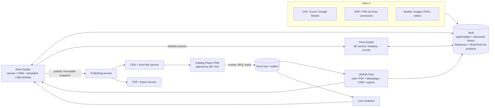
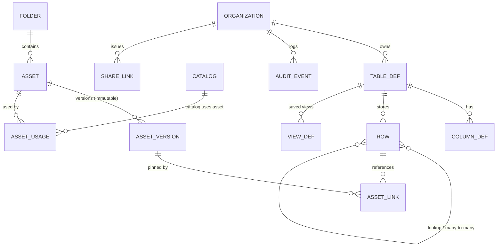
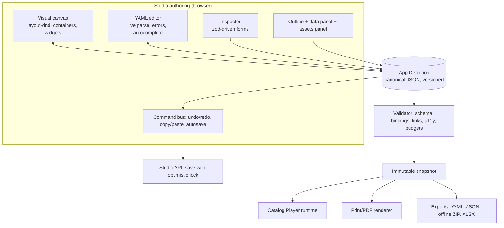
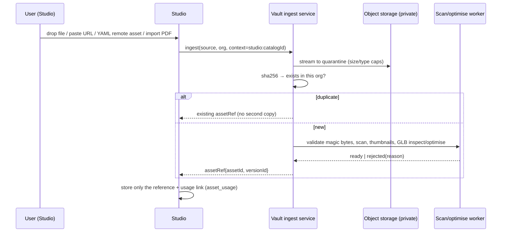
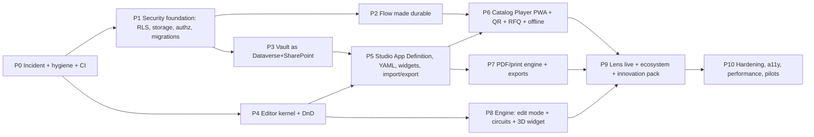

# I3DION MASTER PROMPT v5.0 — Omni Studio ("Power Apps for Catalogs") + Vault ("Dataverse + SharePoint for Products")
**One self-contained document for the developer AI (Google Antigravity or equivalent).** It divides itself into phases, defines security, features, bug fixing and testing, and tells the AI how to run autonomously and safely.
**Repo:** `sabarivasan77/I3DION_Spatial` • **Verified against commit:** `091ea67` (18 Oct 2026) • **Labels:** CONFIRMED / PROPOSED / UNKNOWN

---

## 0. HOW YOU (THE DEVELOPER AI) MUST OPERATE

### 0.1 Autonomy protocol
1. **Create `/docs/execution/PLAN.md` first**: the phase checklist from §9 with status, owner decisions needed, and links to evidence. Keep it updated after every task.
2. **Per phase:** Plan artifact → *(owner approval, see 0.2)* → Builder → Reviewer (fresh context, sees only the diff and spec) → Adversary (attacks: cross-tenant, malformed input, huge files, stale saves, slow network) → UX Critic (screens at desktop + mobile; keyboard-only; anti-"AI look" checklist) → Session Report → Gate.
3. **Autonomous mode:** after a phase's gate is **fully green** (all listed tests pass, CI green, no open Critical/High finding, no pending owner decision), you may start the next phase **without waiting**. **Stop and ask** if: a decision from §10 is needed, a security-sensitive change touches auth/billing/storage/RLS beyond the plan, a test cannot be made green, scope must change, or any destructive action is required (history rewrite, data deletion, key rotation).
4. **Never** break the running product: use feature flags (`ff.<area>.<name>`), strangler migrations, backward-compatible schema changes (expand → migrate → contract), and a rollback note in every PR.
5. **Evidence rules:** "done" = diff + failing-then-passing test + exact command output + (for UI) screen recording. Never write "verified" for something you did not run. If you cannot run something (needs secrets/infra), say **NOT RUN** and why.
6. **Never invent** features, customers, certifications, benchmarks, deployment state, or company data. Use **synthetic data only** in seeds/tests (invented company names — never real brand names or real domains).
7. **Fail closed. No fake success.** UI must never fabricate data or "saved" states. Controls that do nothing are defects; hide them behind a flag.
8. **Secrets:** none in code, logs, docs, tests or chat. If you find one, report the location (not the value) and treat it as compromised.
9. **Commit discipline:** one finding/task per commit, conventional commits, reference IDs (`BUG-xx`, `SEC-xx`, phase IDs). PR template with a security checklist.

### 0.2 Owner approval points (even in autonomous mode)
Phase P0 (incident handling and history rewrite), P1 (RLS/migrations go-live), first production deploy of each phase, and any Decision in §10. Everything else proceeds automatically when green.

### 0.3 Session Report (end of every session)
```
Phase/task IDs | Plan approved? | Changes (files, commits)
Tests added + exact command + exact output | NOT RUN items + reason
Reviewer defects (fixed/justified) | Adversary findings | UX Critic notes + screenshots
Scorecard items moved (before → after, evidence) | Open risks | Decisions needed | Next action
```

---

## 1. VERIFIED PROJECT STATE (what is true today)

### 1.1 What exists (CONFIRMED by reading code at `091ea67`)
| Area | State |
|---|---|
| **Backend** | Express + PostgreSQL modular monolith, ~15k lines. S0 security fixes in place (platform-admin separation, server-side payment orders, atomic signup, per-route rate limits, hashed reset tokens, length-safe webhooks) |
| **Phase S1** | Argon2id passwords, access + rotating refresh tokens with reuse detection, TOTP MFA (optional), `can()` authorization engine present |
| **Flow (new)** | ~13.5k new lines: designer on `@xyflow/react`, executor, outbox dispatcher with SSRF guard, persistence + versions, run history, recipes, import/export, quota service, 7 backend test files |
| **Contracts** | `packages/contracts` (identity, assetRef, event, lead, publishing, catalogComposition, experienceScene, flow) |
| **Studio** | ~15k lines frontend, widgets/templates/logic canvas; 9 defects fixed earlier in `omni-studio-bugfixes.patch` (confirm applied) |
| **Engine** | Viewport UI and a static "puzzles" canvas; **no real transform/keyframe/persistence yet** |
| **Lens** | 9 views running on built-in sample data |
| **Vault** | Largest backend (about 56 routes): assets, products, versions, import/export |

### 1.2 What is wrong (CONFIRMED) — the defect register the AI must fix
| ID | Severity | Defect | Evidence |
|---|---|---|---|
| **SEC-01** | **CRITICAL (incident)** | **20 database backup files (10 `.sql` dumps + metadata) are tracked in git** (added in `b29a313`). The repo clones anonymously → **public**. Dumps contain ~92 distinct email addresses and 35 bcrypt-style password hashes, plus session/token tables. Unknown whether data is real or seeded | `database/backups/*` |
| SEC-02 | High | **No row-level security** (0 policies); tenant isolation relies on hand-written `WHERE` clauses | `backend/src/db` |
| SEC-03 | High | **Uploads served from public static `/uploads`**, no signed URLs; Vault upload route lacks type/signature validation | `server.js`, `routes/vault.js` |
| SEC-04 | High | `can()` authorization engine is **not wired into routes** (routes still use older `requireRole`/`rbac`/`permissions` — three systems) | grep: no `can(` calls in routes |
| SEC-05 | Medium | MFA optional (not enforced for admins); legacy 7-day JWT config still present | `config.js` |
| SEC-06 | Medium | Flow routes only `requireAuth`: no role/permission check per action | `routes/flow.js` |
| BUG-01 | High | **Flow `delay` is faked**: `setTimeout(min(duration*20, 200ms))` — a 3-day wait finishes in 0.2 s | `flowExecutor.js:235` |
| BUG-02 | High | **Flow runs execute inline in the HTTP request** (no queue, scheduler, durable timers, checkpoints, idempotency keys, or retry/backoff worker). A crash loses the run | `routes/flow.js:498` |
| BUG-03 | Medium | Flow "PDF spec generator" returns a download URL; no PDF rendering code found **[verify]** | `flowExecutor.js:370` |
| BUG-04 | High | **Database schema is created at runtime** inside `pool.js` (`CREATE TABLE IF NOT EXISTS …`, incl. flow tables) plus patch scripts; two `schema.sql` files | `db/pool.js`, `database/schema.sql` |
| BUG-05 | High | **216 TypeScript errors**; `npm run build` does not type-check | `tsc --noEmit` |
| BUG-06 | Medium | 9 React `exhaustive-deps` warnings in Studio; ~131 `any` in Studio | eslint |
| BUG-07 | Medium | Frontend `offlineFallback` / mock data paths and `mockData.ts` still present; Lens shows sample data | `services/api.ts`, `features/lens` |
| BUG-08 | Medium | **No CI**; 10+ backend test scripts exist but nothing runs them automatically | no `.github/workflows` |
| BUG-09 | Medium | Seed/demo data uses real-looking company domains (e.g. well-known brands) — legal and reputational risk | dump + seeds |
| BUG-10 | Low | Repo clutter: 33 root markdown files, binaries (30 glTF files, 36 PNG) tracked, `.pyc`, `playwright-report/`, `test-results/`, duplicate `.js`+`.ts` configs/tests, empty root `src/` | see §8 |
| MKT-01 | High | Public pages show unsubstantiated claims ("Zero Trust", a "99.9%" figure) | UI copy |

**Re-score (estimate, tests not run by reviewer): about 50 / 100 — Beta band.** Target after this prompt: ≥ 72 (market-competitive in a niche).

---

## 2. MARKET UNDERSTANDING

### 2.1 What the market looks like (from public sources reviewed 18 Oct 2026)
- **Interactive catalog tools** (Flipsnack, Catalogy, Paperturn, 3D Issue and similar) turn PDFs or product data into web catalogs with QR/trackable links, analytics and lead/RFQ capture. Typical promises: live product data (ERP/PIM/Sheets sync), updates without changing links/QR codes, password-protected catalogs, bulk link import, custom domains, Zapier integration.
- **Low-code app builders** (Microsoft Power Apps and similar) win on drag-and-drop composition, data-source binding, formulas, and governance — but are **not** designed for 3D/AR product experiences or QR-driven public catalogs.
- **3D/AR commerce platforms** (Threekit, VNTANA and similar) win on 3D asset pipelines but are enterprise-priced and heavy for dealers and small manufacturers.
- **Data/document backbones** (Dataverse, SharePoint, PIM/DAM tools) provide typed tables, relationships, permissions, versioned files — but are generic, not product-catalog-native, and not tied to publishing + AR.

### 2.2 Problems → solutions we will implement
| # | Market problem | I3DION solution (feature) |
|---|---|---|
| 1 | **Outdated PDFs and prices circulate**; wrong info lowers buyer trust | One source of truth in Vault; catalogs bind to live rows; **QR/short links never change when republished**; version badges |
| 2 | **No visibility after sending** a catalog | Engagement events (page, product, hotspot, AR launch, RFQ) → Lens; per-QR/per-dealer attribution |
| 3 | **Buyers hunt through 200-page PDFs**; 50 MB attachments | Mobile-first web catalog (Player), search/filter/compare, QR instead of attachments |
| 4 | **Complex products can't be explained in 2D** | Embedded 3D viewer + AR "place it here" + hotspots, with spec cards |
| 5 | **Catalog production takes weeks** (InDesign, agencies) | Drag-and-drop + **YAML paste** + templates + spreadsheet-to-catalog + PDF-to-interactive importer; AI draft assist |
| 6 | **Each dealer/region needs a variant** (language, price list, product set) | Audience variants: dealer-specific links, price lists, languages, visibility rules enforced **server-side** |
| 7 | **Leads get lost** (QR scan → nothing happens) | Quote basket/RFQ → Core lead → I3DION Flow (assign, WhatsApp/email alert, SLA timer) |
| 8 | **Trade shows with bad connectivity** | Offline PWA mode: pre-cached catalog + models, leads queue and sync later |
| 9 | **Print still matters** | Print-grade PDF generated from the *same* definition (no re-design) |
| 10 | **Data scattered** in Excel/ERP/Drive | Vault typed tables + CSV/XLSX/Sheets import-export + scheduled sync via Flow |
| 11 | **India-specific**: WhatsApp-first selling, GST quotes, multilingual | WhatsApp deep links/alerts, GST-ready quote fields (PROPOSED; validate with an accountant), Hindi/Tamil/English |
| 12 | **Low-code tools are unsafe or sprawling** | Governed definitions: validated schemas, versioned snapshots, RBAC, audit, no arbitrary code |

### 2.3 Positioning
"**Build once in Vault, design in Studio, publish by QR, automate with Flow, learn in Lens.**" The only catalog platform that combines *product data backbone + low-code app builder + 3D/AR + automation* for industrial sellers, priced for India's mid-market.

---

## 3. PRODUCT VISION & ARCHITECTURE

### 3.1 System context


### 3.2 Vault = "Dataverse + SharePoint" for products (mapping)
| Microsoft concept | Vault capability (to build) |
|---|---|
| Dataverse **tables, columns, relationships** | **Schema designer**: user-defined tables and typed columns (text, number, currency, unit-number, date, boolean, choice, multi-choice, lookup, many-to-many, rollup, formula, URL, file, **3D model ref**, **image gallery**) |
| Dataverse **views, forms, business rules** | Saved views (filters/sort/grouping), form layouts, validation + calculated-column rules |
| Dataverse **security roles, column security** | Org roles + table/row/**column-level** permissions (e.g. hide `dealer_price` from public audience) |
| SharePoint **document library** | Folders, metadata, **versions (major/minor)**, trash/restore, retention labels, share links with expiry/password, previews (PDF, image, GLB), full-text search, duplicate detection (SHA-256) |
| SharePoint **lists + Power Query** | CSV/XLSX/Sheets import with column mapping, validation report, upsert by key; scheduled sync (Flow) |
| Audit / compliance | Append-only hash-chained audit log, exportable |
| APIs | REST + OpenAPI for every table; webhooks and events; Flow connector |

### 3.3 Vault data model (core)

Built-in starter tables (editable): **Products, Variants, Specs, Price Lists, Categories, Collections, Documents, Dealers**. Row storage: typed columns for system tables; for user-defined tables use JSONB `data` with a per-table generated schema + indexed key columns (PROPOSED; benchmark at 100k rows).

### 3.4 Omni Studio architecture

**Canonical model:** the **App Definition (JSON)** is the single source of truth. The visual canvas and the YAML editor are two *views* of it (round-trip safe). The Player and PDF renderer only consume published snapshots.

---

## 4. OMNI STUDIO — REQUIRED FUNCTIONS

### 4.1 Artifact types
1. **Interactive Catalog App** (primary): multi-page, data-bound, 3D/AR, search/filter/compare, quote basket.
2. **Print/PDF Catalog**: page-based layout from the same definition (A4/A5/Letter, margins, TOC, page numbers, product QR codes).
3. **Microsite / landing page** (single product or campaign).
4. **Presenter mode** (rep shows catalog on a tablet; one-screen first).

### 4.2 Editor functions (drag-and-drop and beyond)
| Function | Behaviour |
|---|---|
| **Drag-and-drop** | Palette → canvas into nested containers at an index; reorder; re-parent; multi-select; duplicate (Alt); axis lock (Shift); free-canvas snapping + alignment guides; mouse + touch + keyboard; auto-scroll; invalid drops rejected with reason (algorithm in §4.4) |
| **Copy / paste** | Within a catalog, across pages and across catalogs/tabs (clipboard carries versioned JSON with asset refs; IDs remapped; Vault references preserved or re-linked); paste as YAML text |
| **YAML paste/edit** | Paste a full or partial YAML snippet → instant parse, line-level errors, preview; "Apply" merges into the definition as one undoable command. Round-trip preserves comments where possible (use a CST-preserving YAML library) |
| **Import** | YAML/JSON definition; **CSV/XLSX/Google Sheets → Vault rows → auto-generated catalog**; **PDF → interactive pages** (render pages as images + text layer; detect product codes; add hotspots linking to Vault rows); images/videos/GLB drag-dropped from desktop |
| **Export** | YAML, JSON, offline HTML bundle (ZIP) for kiosks, **print PDF**, XLSX/CSV of bound data, QR sheet (SVG/PNG/PDF) |
| **Undo/redo/versions** | Infinite undo within a session; named versions with diff (structural) and rollback; autosave with optimistic lock (409 → conflict dialog) |
| **Templates & themes** | Templates for product-line catalog, dealer price list, trade-show kit, spec sheet; brand tokens (colour, font, radius, spacing); dark/light |
| **Responsive** | Desktop/tablet/mobile preview and per-breakpoint overrides |
| **Data binding** | Bind any widget/container to a Vault table/view; expressions `{{ item.name }}`, filters, sort, pagination, lookups; **safe expression language** (no JavaScript) |
| **Multi-language** | Per-field translations, language switcher, fallback chain; draft machine translation always marked "needs review" |
| **Comments & review** | Comments on widgets, assign reviewer, approval before publish (via Flow) |
| **Validation panel** | Broken links, missing assets/alt text, unbound fields, price mismatch, oversize models, contrast failures, unreachable pages — blocks publish on errors |
| **Collaboration** | v1: presence + soft locks; real-time co-editing (CRDT) later |

### 4.3 Widget catalog (v1; every widget registers a `BlockDef`)
- **Layout:** Page, Section, Stack (flex), Grid, **Free canvas**, Tabs, Accordion, Carousel, Modal/Drawer, **Repeater** (data-bound), Divider/Spacer.
- **Content:** Heading, Rich text (sanitised), Image, Gallery, Video, **3D Viewer** (Engine scene, AR button, hotspots), Hotspot image, Spec table, Badge/Tag, Price, Download button, Document viewer.
- **Product:** Product card, Product detail, Variant picker, Compatibility/Related, Spec compare, BOM table.
- **Interaction:** Button, Search box, Filters, Sort, Compare tray, **Quote basket**, **RFQ form**, Lead form, QR block, WhatsApp button, Share button.
- **Navigation:** Header, Menu, Breadcrumb, Table of contents, Page-turn (flipbook) mode, Footer.
- **Data/layout helpers:** Conditional visibility, Language switcher, Theme switcher.
Each widget: props schema (zod), inspector form, container `accepts` rules, validation, accessibility defaults, print behaviour, Player renderer, test fixtures.

### 4.4 Drag-and-drop algorithm (must be implemented exactly)
```
state: tree of nodes { id, type, children[], layout{mode: stack|grid|free|tabs|repeater} }
dragStart(source = paletteItem | existingNode):  capture pointer offset; show DragOverlay
dragMove(pointer):
   candidates = containers whose rect contains pointer
   target     = deepest candidate with accepts(source.type) AND not isDescendant(source, candidate)
   if target.layout ∈ {stack, tabs, grid, repeater}: index = insertionIndex(pointer, childRects, axis); show indicator
   if target.layout == free: pos = snap(pointer - offset, grid=8, guides=sibling edges/centres)
   autoScroll when within 40px of scroll edge
drop:   dispatch ONE undoable command (InsertNode | MoveNode(target, index|pos))
rules:  no drop into self/descendants • capacity limits • Alt=duplicate • Shift=axis lock
        multi-select drags as a group • touch: long-press to lift • keyboard: Space lift, arrows move, Space drop
perf:   ≥ 60 fps with 500 nodes; virtualise long lists
```
Libraries (PROPOSED): `dnd-kit` for layout (or Atlassian pragmatic-drag-and-drop after a 2-day spike), `@xyflow/react` for graphs (already installed), `yaml` (CST-preserving) for YAML, `zod` for schemas, `DOMPurify` for rich text. All behind adapters.

### 4.5 YAML specification (App Definition view)
```yaml
schema: i3dion.catalog/1
meta: { name: "Industrial Compressors 2027", slug: compressors-2027, languages: [en, hi, ta], defaultLanguage: en }
theme: { preset: industrial-light, primary: "#2563EB", font: Inter, radius: 8 }
data:
  sources:
    products: { vault: Products, filter: "status = 'active' AND category = 'Compressors'", sort: [name asc], pageSize: 24 }
variables:
  family: { type: text, default: "" }
pages:
  - id: home
    title: Home
    layout: stack
    children:
      - type: hero
        props: { title: "{{ meta.name }}", image: asset:hero-banner }
      - type: filters
        props: { fields: [series, power_kw, pressure_bar], bind: products }
      - type: product-grid
        bind: products
        props: { columns: 3, card: { title: "{{ item.name }}", image: "{{ item.photo }}", badge: "{{ item.series }}" } }
        on: { itemClick: { navigate: product-detail, params: { id: "{{ item.id }}" } } }
  - id: product-detail
    route: /p/:id
    children:
      - type: viewer-3d
        props: { model: "{{ product.model3d }}", ar: true, hotspots: from-scene }
      - type: spec-table
        bind: product.specs
      - type: button
        props: { label: "Add to quote" }
        on: { click: { action: basket.add, with: { product: "{{ product.id }}" } } }
```
**Rules:** unknown keys are errors (no silent ignore) • `asset:<name>` resolves to a Vault asset; a plain `https://` URL is **auto-imported into Vault** on save (SSRF-safe) and replaced with `asset:` • expressions are parsed by the restricted engine (no JS) • size ≤ 1 MB, depth ≤ 32, alias/anchor expansion disabled or capped, custom YAML tags rejected • every error carries `line:column` and a fix hint.

### 4.6 Catalog Player (the browser app users open by QR)
- **Delivery:** `https://<tenant-domain>/<slug>` or short link `/q/<id>`; installable **PWA**; server-rendered/pre-rendered first paint for SEO and speed; static assets on CDN.
- **Features:** pages, search, filters, compare, 3D viewer + AR (capability detection and fallbacks), quote basket → **RFQ form** → lead, WhatsApp share/ask, language switch, download PDF, password-protected or expiring or **dealer-personalised** links, cookie-free visitor ID with consent mode.
- **Offline mode:** service worker caches pages, images and (optional) models for chosen catalogs; RFQs queue and sync with idempotency keys; clear offline indicator (never fake success).
- **Performance budgets:** LCP ≤ 2.5 s on a mid-range phone over 4G; initial JS ≤ 200 KB gzip; model streamed with poster; images responsive + lazy.
- **QR system:** stable short IDs (≥ 96 bits entropy, non-enumerable) that **never change on republish**; each QR has a label and campaign (e.g. "Chennai Expo 2027") for attribution; print-ready QR export; "QR-attributed visit" is the metric name (never "scan").
- **Analytics events:** `catalog.viewed`, `page.viewed`, `product.viewed`, `hotspot.opened`, `viewer.3d_interacted`, `ar.launch_attempted/succeeded`, `basket.item_added`, `rfq.submitted`, `download.pdf`, `share.clicked` — whitelisted, size-capped, deduped.
- **Security:** published bundle contains **no secrets and no hidden prices** (audience-restricted fields are filtered **server-side** per link); strict CSP; rate-limited forms with bot checks; consent flag stored.

### 4.7 PDF catalog engine
Print stylesheet on the **same definition**: page size/margins, repeating headers/footers, TOC with page numbers, product QR codes, 3D snapshot images, row-repeating spec tables, avoid-break rules. Rendered by isolated headless-Chromium workers (timeouts, memory caps, sanitised templates, no remote fetch except allow-listed assets), output to private storage, signed link. v1 = **RGB PDF** (PDF/X, CMYK, bleed/crop marks are out of scope and must be stated honestly). Batch generation (e.g. 1,000 dealer-specific PDFs) via Flow.

### 4.8 Auto-save to Vault ("every asset goes into the Vault")

Rules: Studio **never stores binaries**; only `assetRef`. Assets created from Studio are auto-filed under `/Catalogs/<catalog>/` with tags `source:studio`, deduplicated by hash, versioned, and listed in "Used in" on the asset page. Replacing an asset creates a new version; published snapshots stay pinned until the owner chooses "update published items".

---

## 5. INNOVATION IDEAS (build in this priority order)
| # | Idea | Value | Effort | Phase |
|---|---|---|---|---|
| 1 | **PDF → Living Catalog** importer (detect product codes, link to Vault rows, auto hotspots) | Converts the customer's existing asset in minutes | M | P5 |
| 2 | **Scan-to-quote with context** (QR carries product + campaign; RFQ prefilled; Flow assigns, WhatsApps owner, starts 24-h SLA) | Closes the lead loop | S | P6 |
| 3 | **Dealer-personalised catalogs** (personal links, price lists, visibility, language) enforced server-side | Strong B2B differentiator | M | P6 |
| 4 | **AR fit-check** (1:1 scale with footprint/clearance overlay from Vault specs) | Unique for industrial equipment | M | P8 |
| 5 | **Offline trade-show mode** (pre-cache + queued leads) | Real pain at expos | M | P6 |
| 6 | **Catalog health score** (broken links, missing alt text, no 3D, price mismatch, a11y) | Quality and trust | S | P5 |
| 7 | **Engagement heatmaps** (page/hotspot level) feeding "fix this" suggestions | Proves ROI | M | P9 |
| 8 | **India-ready quote PDF** (GST fields, HSN, validity, terms) via Flow — validate rules with an accountant | Local fit | S | P7 |
| 9 | **Multilingual drafts** (Hindi/Tamil/English) with a human review gate | Reach | M | P5 |
| 10 | **AI assist** (spreadsheet → catalog draft, descriptions, alt text) — human-in-the-loop, org opt-in, no customer data used for training | Speed | M | P9 |
| 11 | **Presenter mode** (rep controls what a customer tablet shows) | Sales meetings | M | P9 |
| 12 | **Template marketplace** (curated, later) | Network effects | L | post-pilot |

---

## 6. FLOW INTEGRATION (so the ecosystem is one product)
- **Events from Studio/Vault/Player (triggers):** `catalog.published`, `asset.version_uploaded`, `product.updated`, `rfq.submitted`, `lead.created`, `qr.visit_threshold`, `sync.completed/failed`.
- **Actions into products:** Vault (upsert rows, tag/approve assets, import sheet), Studio (create catalog from template + data, export PDF), Hub (create QR/short link), Lens (run report), Core (invite user).
- **Flagship recipe ("Trade-show kit"):** *Spreadsheet updated → Vault upsert → Studio regenerates dealer catalogs → PDFs generated → email + WhatsApp to dealers → RFQs → lead assignment + SLA → weekly Lens PDF report.*
- **Required Flow fixes first (BUG-01/02):** durable queue, real timers, idempotent steps, retry/backoff worker, scheduler. Flow must not run user flows inline in HTTP requests.

---

## 7. SECURITY (binding for every phase)
**Baseline (implement exactly, then test):**
1. **Passwords:** Argon2id (64 MiB, t=3, p=1); upgrade-on-login; 12+ chars; breached-password check; generic errors; timing equalised.
2. **Sessions:** 10-min access JWT + rotating refresh token (HttpOnly, Secure, SameSite cookie, hashed at rest, **reuse detection revokes the family**), `token_version` for global revoke; no tokens in `localStorage`; **MFA mandatory for Owner/Admin and platform staff**; remove legacy 7-day tokens.
3. **Authorization:** one `can(actor, action, resource)` function — deny by default; role from **org membership**; resource tenant check; explicit permission matrix; entitlement check; audit sensitive actions. **Every route declares a policy; CI fails if one doesn't.** Platform staff is a separate identity realm with its own login and MFA.
4. **Tenant isolation:** PostgreSQL **RLS on every tenant table** (`FORCE ROW LEVEL SECURITY`), non-owner app role without `BYPASSRLS`, `withTenant(orgId, fn)` helper using a dedicated client and `set_config('app.org_id', …, true)`; unset org ⇒ zero rows. Tests must prove isolation even when a `WHERE organization_id` clause is deliberately removed.
5. **Storage:** private bucket, server-generated keys (`org/{orgId}/assets/{uuid}`), pre-signed upload/download (≤ 5 min), magic-byte validation, size/type caps, GLB structural checks (header, length, no external URIs), image re-encode with EXIF stripping, PDF active-content rejection, optional AV scan, `nosniff`; remove public `/uploads`.
6. **Throttling:** login (IP / account / pair windows, escalating delay, temporary block not permanent lock), signup, forgot/reset, public leads/RFQ, public events; CAPTCHA step on abuse.
7. **One-time tokens:** 256-bit random, store SHA-256 only, single-use via atomic update, short expiry, never logged.
8. **Payments:** server-side `orders`, plan from stored order only, confirm with provider API, idempotent by payment ID, webhook as source of truth, daily reconciliation.
9. **Audit:** append-only, hash-chained per org; login/MFA/role/publish/export/billing/share-link/admin actions; exportable.
10. **Secrets & config:** env schema validated at boot; fail fast; separate keys per environment; rotation runbook; secret scanning in CI **and over full git history**.
11. **Logging:** structured, redacted (auth headers, cookies, tokens, payment payloads, PII in Flow runs), request IDs.
12. **Headers/CORS:** strict CSP, HSTS, `nosniff`, frame-ancestors; CORS allowlist only.

**Studio/Vault/Player-specific controls:**
- **YAML/JSON import:** size/depth limits, no custom tags, no alias bombs, schema-validated, errors never echo untrusted content unescaped.
- **Rich text & HTML-ish widgets:** sanitise with DOMPurify on save *and* render; no inline scripts; CSP blocks inline JS.
- **Expressions:** restricted evaluator, no property access to prototypes, step/time limits, no I/O.
- **URL imports:** https only, DNS-resolved private/link-local/metadata ranges blocked, 10 s timeout, 25 MB cap, redirects re-validated.
- **CSV/XLSX:** formula-injection guard on export (prefix cells starting `= + - @` with `'`), zip-bomb and row/column caps on import, parse in a worker with memory/time limits.
- **PDF import/render:** isolated worker, page cap, timeouts, no network.
- **Published Player:** audience filtering on the server; hidden fields never sent; unguessable IDs; password protection checked server-side (hashed); expiring/revocable links; per-link rate limits; no cross-tenant caching (cache key includes org + link).
- **Seeds/tests:** synthetic data only; never commit database dumps.

---

## 8. REPOSITORY STRUCTURE (clean, human-readable, editable)

### 8.1 Principles
One place per thing • organise by **product/function (domain), not by file type** • every top-level folder has a `README.md` explaining purpose, owner, how to run • public API of each package is its `index.ts` (no deep imports) • generated, build and test-output files never in git • naming: folders `kebab-case`, React components `PascalCase.tsx`, hooks `useThing.ts`, tests `thing.test.ts` beside the code • `CODEOWNERS` per area • dependency boundaries enforced by lint • max file length warning at 400 lines.

### 8.2 Target tree (Stage 1: modular monorepo, keep one web app)
```
i3dion/
├─ README.md                    # what it is, 5-minute quick start, map of the repo
├─ CONTRIBUTING.md  SECURITY.md  CODEOWNERS  LICENSE
├─ package.json  pnpm-workspace.yaml  tsconfig.base.json  turbo.json (optional)
├─ .github/  workflows/ (ci.yml, security.yml, deploy.yml)  PULL_REQUEST_TEMPLATE.md
│
├─ apps/
│  ├─ web/                      # the React SPA (was /frontend)
│  │  └─ src/
│  │     ├─ app/                #  routing, providers, shell, launcher, command palette
│  │     ├─ products/           #  ONE FOLDER PER PRODUCT (feature-first)
│  │     │   ├─ home/  vault/  studio/  engine/  flow/  hub/  lens/  settings/  auth/
│  │     │   │   each: pages/ components/ state/ api/ hooks/ types/ index.ts
│  │     ├─ platform/           #  cross-product UI: notifications, approvals, search
│  │     └─ shared/             #  small helpers only (format, device, lazyWithRetry)
│  ├─ player/                   # Catalog Player PWA (public runtime; separate bundle, tiny)
│  └─ mobile/                   # React Native app (was /mobile)
│
├─ services/
│  ├─ api/                      # Express modular monolith (was /backend)
│  │  └─ src/
│  │     ├─ app/  (server.ts, config.ts, routes registry, error handler)
│  │     ├─ modules/            #  vertical slices, ONE FOLDER PER DOMAIN
│  │     │   ├─ core/ (auth, sessions, mfa, orgs, members, permissions, audit, notifications)
│  │     │   ├─ billing/  vault/  studio/  engine/  hub/  lens/  flow/  leads/  publishing/
│  │     │   │   each: routes.ts service.ts repo.ts schemas.ts policy.ts events.ts tests/
│  │     ├─ platform/           #  db pool, rls helper, queue port, storage port, email port, rate limiters
│  │     └─ index.ts
│  └─ worker/                   # background jobs: flow executor, scheduler, PDF, ingest/scan, thumbnails
│
├─ packages/
│  ├─ contracts/                # shared schemas + event types (zod)
│  ├─ sdk/                      # typed API client (generated from OpenAPI)
│  ├─ design-system/            # tokens, components, motion
│  ├─ editor-kernel/  layout-dnd/  graph-editor/  block-registry/   # shared editor foundations
│  ├─ viewer-3d/                # 3D/AR runtime (Engine, Player, Hub share it)
│  ├─ catalog-runtime/          # App Definition → rendered pages (Player + print)
│  └─ config/                   # eslint, tsconfig, prettier presets
│
├─ db/
│  ├─ migrations/               # forward-only, numbered; run by CI/deploy, never on request
│  ├─ policies/                 # RLS policies as SQL
│  └─ seeds/                    # SYNTHETIC data only
│
├─ infra/                       # docker, compose, deploy scripts, env templates (.env.example)
├─ tools/                       # dev/ops scripts (one-off scripts live here, not in app roots)
├─ tests/                       # e2e (Playwright), load (k6), security suites
├─ assets/                      # brand, demo models (small, via Git LFS or external storage)
└─ docs/
   ├─ 00-overview.md  01-architecture.md  02-getting-started.md
   ├─ product/  (PRD, specs, design system PDFs)
   ├─ architecture/  (diagrams, ADRs in adr/)
   ├─ security/  (threat model, policies, trust pack)
   ├─ runbooks/  (deploy, rollback, incident, restore, key rotation)
   ├─ api/  (OpenAPI + guides)
   ├─ execution/  (PLAN.md, session reports, decision register)
   └─ archive/  (old PHASE_* reports and audits — moved, not deleted)
```
**Stage 2 (only if needed later):** split `apps/web/src/products/*` into separate deployable apps. Do **not** do this now: a domain-organised single app is easier for a small team and a human editor.

### 8.3 Migration map (current → target)
| Current | Target | Notes |
|---|---|---|
| `frontend/` | `apps/web/` | `git mv`; keep Vite config; convert `.js` configs/tests duplicates to `.ts` only |
| `frontend/src/features/{studio,logic,scripting,connectors}` | `apps/web/src/products/studio/…` (logic/scripting/connectors become sub-areas, marked **frozen**) | keep behind flags |
| `frontend/src/features/{engine,lens,flow}` | `apps/web/src/products/{engine,lens,flow}/` | |
| `frontend/src/pages/{vault,hub,home,auth,settings}` + loose pages | `apps/web/src/products/<area>/pages/` | loose pages (`LeadManagement`, `ProductFlow`, `SalesIntelligence`…) → their product |
| `frontend/src/components/{studio,vault,hub,billing}` | `products/<area>/components/`; generic ones → `packages/design-system` | |
| `frontend/src/{store,api,services}` | split per product `state/` and `api/`; generic → `shared/` | remove `mockData.ts`, `offlineFallback` |
| `frontend/src/design-system`, `contracts` | `packages/design-system`, `packages/contracts` (already exists — merge) | |
| `frontend/public/models/*.gltf` (33), logos | `assets/` + external storage; keep only tiny placeholders | remove from bundle |
| `backend/` | `services/api/` | ESM, convert to TypeScript progressively |
| `backend/src/routes/*.js` + `services/**` | `services/api/src/modules/<domain>/` | e.g. `routes/vault.js` + `services/vault/*` → `modules/vault/`; `services/intelligence/*`, `trackingEngine`, `scoringEngine`, … → `modules/lens/` (and mark frozen engines) |
| `backend/src/middleware/{auth,authorizationEngine,permissions,rbac,entitlement}` | `modules/core/` + `platform/` — **collapse three authorization systems into one `can()`** | |
| `backend/src/db/{schema.sql, pool.js (runtime tables), patch-*.js, 0x-migrate-*.js}` | `db/migrations/0001_baseline.sql … ` + `platform/db.ts` (no DDL in code) | baseline from a `pg_dump --schema-only` of a clean DB |
| `database/schema.sql`, `database/backups/*` | schema → migrations; **backups deleted from git and history (see P0)** | store backups in encrypted object storage |
| `backend/test-*.js` (≈17 files) | `tests/api/*.test.ts` (one runner, one command) | wire into CI |
| `backend/{check-region,create-bucket,test-all-regions,setup-storage-rls,rename-company}.js`, `scripts/*`, root `add-env.js`, `fix-vercel-env.js`, `deploy.ps1`, `start*.bat/py` | `tools/` (documented) or deleted if obsolete | |
| `backend/api/index.js` + `api/index.js` (duplicates) | one serverless entry under `infra/` or `services/api` | |
| root `src/` (empty skeleton) | delete | |
| 33 root `*.md` (PHASE_*, AUDIT*, README-RUN) | `docs/archive/` (+ keep `docs/review/*`) | |
| `docs/*.pdf`, `docs/*.md` | `docs/product/`, `docs/architecture/`, `docs/runbooks/` | |
| `.design-reference/` | `docs/product/design-reference/` | |
| `scripts/__pycache__`, `frontend/playwright-report`, `frontend/test-results` | **delete + `.gitignore`** | |

### 8.4 Safe migration procedure
1. Record baselines: `tsc --noEmit` error count, test results, `vite build` size.
2. **One move-class per PR**, always `git mv` (history preserved); no behaviour changes in move PRs.
3. Introduce path aliases first (`@web/*`, `@api/*`, `@i3dion/*`), codemod imports (ts-morph/jscodeshift), then move.
4. After each PR: typecheck count must not increase, tests green, build passes, app boots.
5. Add `dependency-cruiser` or `eslint-plugin-boundaries`: products may import `shared`, `platform`, `packages/*`, never another product's internals; modules in the API talk through service interfaces/events, never other modules' tables.
6. Add a **structure test** in CI that fails on: files in repo root outside an allowlist, committed binaries over 1 MB, `*.sql` under any `backups` path, `.env*`, `__pycache__`, duplicate `.js`/`.ts` twins.
7. Write a one-page `docs/01-architecture.md` with the tree above and "where do I put X?" rules.

---

## 9. PHASES (the AI divides and executes these in order; ids are stable)


*(P2, P3 and P4 can run in parallel; frontend-only P4 does not depend on P1.)*

### P0 — Incident, Hygiene, CI (owner approval for history rewrite)
**Do:**
1. **SEC-01:** `git rm --cached -r database/backups`; add ignore rules; **tell the owner immediately** that the repo is public and the dumps contained emails/hashes; decide with the owner: make repo private now; determine whether any rows are real users; if real → force password reset and notify; **plan** a history purge with `git filter-repo` (execute only after approval) and re-scan history with gitleaks; rotate every key that ever lived in the repo.
2. Delete junk: `__pycache__`, `playwright-report`, `test-results`; remove binaries >1 MB from tracking (move to storage); replace real-brand seed data with synthetic (BUG-09).
3. **Stage 1 repo restructure** (§8) in small PRs, starting with the zero-risk moves (docs archive, tools, delete duplicates, dead `src/`), then `frontend → apps/web`, `backend → services/api`.
4. **CI (BUG-08):** `.github/workflows/ci.yml`: install, lint, **`tsc --noEmit`**, unit/integration tests (Postgres service container), Playwright smoke, `npm audit`/OSV (fail on high+), gitleaks, structure test. Branch protection.
5. **TypeScript debt (BUG-05):** fix the 216 errors area by area; then make typecheck a required CI gate. Fix the 9 Studio `exhaustive-deps` warnings (BUG-06).
6. Remove `offlineFallback`, `mockData`, sample-data defaults from production paths (BUG-07); remove unsupported claims from UI/README (MKT-01).
**Gate P0:** repo clean per structure test; CI required and green; typecheck zero errors in touched areas and non-increasing elsewhere; owner confirmation on SEC-01 handling; app boots from new layout.

### P1 — Security Foundation (starts after P0)
RLS on all tenant tables + `withTenant` + app DB role (SEC-02); versioned migration tool, **move all DDL out of `pool.js`**, delete patch scripts after baseline (BUG-04); private storage + signed URLs + upload pipeline + remove `/uploads` (SEC-03); wire `can()` into **every** route and delete the old authorization layers (SEC-04); MFA required for admins, remove 7-day JWT config (SEC-05); permission checks on Flow routes (SEC-06); audit log (hash-chained) with export; security headers/CSP; structured logging with redaction; backups with a **restore drill**; trust-pack documents (honest).
**Tests:** `AUTH-*`, `AUTHZ-*` (every route has a policy; each role×action cell), `TENANT-*` (org B cannot read/update/delete/list/export org A for every resource, via API and direct SQL under the app role), `UPLOAD-*`, `TOKEN-*`, `HDR-*`, `SUPPLY-*`.
**Gate P1:** all above green in CI; RLS proof test passes with the `WHERE` clause removed; no public file URL works without a valid signature; owner approves production migration.

### P2 — Flow Made Durable
**Fix BUG-01/02/03:** `QueuePort` with a Postgres-backed adapter (`graphile-worker` or `pg-boss`); runs enqueue and return immediately; **worker** executes with **checkpoint after every step**, retries with exponential backoff + jitter, dead-letter, idempotency key per step (`run_id:step_id`), **real durable timers** (`wait`/`delay-until` stored as `resume_at`, claimed with `FOR UPDATE SKIP LOCKED`), cron scheduler with leader lock, loop/depth guard, per-tenant fairness (token bucket + weighted round-robin), quota enforcement atomic, chunked for-each fan-out with concurrency cap, large payloads by reference; real PDF/report/email/WhatsApp adapters (sandbox first) behind connector interfaces; RBAC per flow action.
**Tests (`FLOW-*`):** duplicate event → one run • kill worker mid-run → resumes without repeating side effects • a 3-day delay survives restart • failing adapter retries then dead-letters and alerts • cross-tenant isolation • private-IP webhook blocked • secrets never in responses/logs • 10,000-item for-each completes in chunks • noisy tenant cannot starve another's interactive lane • load test with published numbers (no claims beyond measurements).
**Gate P2:** all green; demo flow "new lead → assign → WhatsApp (sandbox) + email → 24-h SLA escalate" works across a restart.

### P3 — Vault as Dataverse + SharePoint
**Build (§3.2, §3.3):** schema designer (tables, typed columns, relationships, formula/rollup), views and forms, validation/business rules, row/column-level permissions with audience-safe projections, document library (folders, versions major/minor, trash/restore, share links with expiry/password, previews incl. GLB, full-text search, SHA-256 duplicate detection), **CSV/XLSX/Sheets import with mapping + validation report + upsert**, export with formula-injection guard, public REST/OpenAPI + webhooks + events, Flow connector, auto-ingest service (§4.8) with usage tracking (`asset_usage`), audit trail UI, quotas by plan.
**Tests (`VAULT-*`):** 100k-row import (time/memory recorded) • column permission hides a field from an audience link • duplicate upload returns the same asset • version rollback • formula-injection export test • cross-tenant negatives • relationship integrity (delete restrictions) • API contract tests.
**Gate P3:** non-technical tester imports a spreadsheet, adds a lookup column, saves a view, uploads a model, and finds it by search in ≤ 10 minutes.

### P4 — Editor Kernel & Drag-and-Drop
**Spike (2 days → ADR):** dnd-kit vs pragmatic-drag-and-drop; confirm `@xyflow/react`. **Build:** `editor-kernel` (document store, command bus with undo/redo/merge, selection, clipboard with ID remap, autosave + optimistic lock), `block-registry` (`BlockDef` with ports, zod params → inspector, container rules, validation), `layout-dnd` (algorithm §4.4), `graph-editor` wrapper. **Migrate** the Studio widget canvas and the logic canvas behind flags (strangler); keep old paths until tests pass.
**Tests (`DND-*`, mouse + touch + keyboard):** drop into nested container at index 0/middle/end • reject self/descendant drop with message • reorder/re-parent/duplicate • undo/redo ×10 identical • save → reload identical • keyboard lift/move/drop with screen-reader announcements • graph: typed-port mismatch rejected, cycle rejected, delete wire, multi-select drag, copy/paste • 500-node ≥ 60 fps; 1,000-node graph smooth.
**Gate P4:** all DND tests green on Chromium + WebKit; zero TS errors in the new packages.

### P5 — Omni Studio: App Definition, YAML, Widgets, Import/Export
**Build (§4.1–§4.5):** App Definition schema (`i3dion.catalog/1`) in `packages/contracts` with versioning/migrations; widget catalog v1 (§4.3) via `BlockDef`; data binding to Vault with safe expressions; **YAML view with live parse, errors, apply-as-one-command, comment-preserving round-trip**; copy/paste across pages/catalogs/tabs; import (YAML/JSON, CSV/XLSX → generated catalog, **PDF → interactive pages**); export (YAML/JSON/offline ZIP/XLSX); templates (4) + brand tokens; responsive breakpoints; multilingual fields; comments + review state; **validation panel / catalog health score**; versions + diff + rollback; publish pipeline (validate → immutable snapshot → short link). Fix remaining Studio defects (BUG-06); retire the "compiler" naming; keep iScript/LogicCraft **frozen**; provide a converter for existing logic nodes.
**Tests (`YAML-*`, `STUDIO-*`):** valid/invalid YAML corpus (200 cases incl. alias bombs, custom tags, oversize, deep nesting) • YAML ⇄ canvas round-trip equality (property-based tests) • paste partial YAML merges as one undoable command • copy/paste across catalogs remaps IDs and keeps asset refs • import of 3 real-world-shaped PDFs yields pages + hotspots • remote URL in YAML is auto-ingested to Vault and rewritten to `asset:` • publish blocked by 10 seeded validation errors • published snapshot unaffected by later asset edits • XSS payloads in rich text neutralised.
**Gate P5:** a non-technical tester builds and publishes a branded 20-product catalog from a spreadsheet in ≤ 15 minutes, edits it via YAML and canvas interchangeably, and exports it.

### P6 — Catalog Player (PWA), QR, RFQ, Offline
**Build (§4.6):** `apps/player` + `packages/catalog-runtime`; CDN publishing; pre-rendered first paint; short-link service (non-enumerable IDs, never change on republish); QR export (SVG/PNG/print sheet) with campaign labels; search/filter/compare; **quote basket + RFQ → lead → Flow**; WhatsApp share/ask links; language switch; password/expiring/**dealer-personalised** links with **server-side audience filtering**; service worker offline cache with queued, idempotent RFQs; consent-aware analytics events; 3D viewer + AR with capability fallbacks; accessibility pass.
**Tests (`PLAYER-*`):** hidden price never present in network payload or bundle for an audience that must not see it • republish keeps QR/link working • offline: browse cached catalog, submit RFQ, reconnect → exactly one lead • link enumeration attempts fail • password-protected link rejects without server-side check • LCP/JS budgets on a mid-range Android profile • AR fallback on unsupported device • rate-limit and bot checks on RFQ • cache keys never mix tenants.
**Gate P6:** scan a printed QR on two real phones (iOS + Android) → catalog opens ≤ 3 s → 3D/AR works → RFQ creates a lead → Flow notifies the owner. Screen recording attached.

### P7 — PDF / Print Engine & Exports
**Build (§4.7):** print renderer from the App Definition; isolated worker pool; TOC, headers/footers, QR codes, 3D snapshots; batch dealer PDFs via Flow; India-ready quote PDF template (GST fields; PROPOSED); watermark; private storage + signed links.
**Tests (`PDF-*`):** 1,000-PDF batch with progress, partial-failure policy and resume • template with remote URL rejected • p95 single PDF < 10 s • visual regression of 5 reference catalogs • memory/time caps enforced • text selectable and links working.
**Gate P7:** a 60-page catalog PDF generated from the same definition as the web app with matching content; honest "RGB only" note present.

### P8 — Omni Engine: Edit Mode, Circuits, 3D Widget
(Per the Engine spec: real TransformControls, selection/outliner, collections, keyframe timeline, materials/textures, cameras/views, persisted Scene Document, then Circuits on `graph-editor` with ~70 Chips, compiled to IR and interpreted in `viewer-3d`.) **Studio integration:** `viewer-3d` widget loads a published scene; hotspots from scene; AR button; Circuits events (`Submit Lead`, `Track Event`, `Emit Flow Event`) wired to Core/Lens/Flow.
**Tests (`ENG-*`):** move/rotate/scale/recolour/hide/keyframe → undo ×N/redo ×N → save → reload identical, original GLB hash unchanged • stale save → 409 • malicious/huge circuit rejected, infinite loop stopped • same IR gives same result in editor and Player • 30 fps on mid-range phone with a 10 MB model.
**Gate P8:** the demo "click part → animation → variant → spec card → quote request" works in editor, Player and on a phone.

### P9 — Lens Live, Ecosystem, Innovation Pack
Replace sample data with live event ingestion (whitelist, dedupe, caps) and written metric definitions; funnels (visit → 3D → AR → RFQ → lead), per-QR and per-dealer reports, heatmaps; unified notifications + approvals centre; command palette across products; "Use in Flow" actions; build the innovation items assigned to P9 (§5); the **Trade-show kit** recipe end to end.
**Tests (`LENS-*`, `E2E-*`):** every metric traceable to a definition and source table • no `Math.random`/sample data reachable in production build (CI grep) • the Trade-show recipe runs end to end on staging (recording).
**Gate P9:** scorecard re-run with evidence.

### P10 — Hardening, Accessibility, Performance, Pilots
Independent penetration test and fixes; restore drill; WCAG 2.2 AA audit; performance budgets met (Hub/Player LCP ≤ 2.5 s mid-range phone on 4G); load tests; billing end-to-end (plans purchasable, limits enforced, receipts); onboarding checklist; help docs; legal pages (privacy, terms, DPA template, sub-processor list — reviewed by a professional); 2–3 pilot customers on the flagship story; backlog from feedback.
**Gate P10 (market-ready):** scorecard ≥ 70; no open Critical/High; pilot customer completes the flagship story unaided.

---

## 10. DECISIONS FOR THE OWNER (AI recommends; owner decides)
| ID | Decision | Recommendation |
|---|---|---|
| D-1 | Make the repo **private now**; purge dumps from history | Yes (P0) |
| D-2 | Repo structure Stage 1 (single web app, domain folders) | Approve §8 |
| D-3 | DnD library: dnd-kit vs pragmatic-drag-and-drop | Decide after the 2-day spike |
| D-4 | Queue for Flow: `graphile-worker`/`pg-boss` on Postgres | Yes for pilots |
| D-5 | Vault user-defined table storage (JSONB + indexed key columns) | Yes; benchmark at 100k rows |
| D-6 | Player hosting/domain strategy (subdomain per tenant, custom domains later) | Subdomain first |
| D-7 | PDF scope v1: RGB only; PDF/X later | Yes |
| D-8 | WhatsApp provider (official Business Platform via a BSP) | Evaluate pricing/approval time |
| D-9 | Pricing packaging: Studio+Vault core; Flow runs metered as add-on | Yes |
| D-10 | AI assist: opt-in, no customer data for model training, human review | Yes |
| D-11 | Frozen modules (iScript, LogicCraft text, DataBridge, intelligence engines, AI gateway) | Keep frozen until two paying pilots |

---

## 11. TESTING & BUG-FIXING PROTOCOL
- **Pyramid:** unit (schemas, commands, expressions, permission matrix, parsers) → integration (API + DB with RLS, queue, storage emulator) → E2E (Playwright: mouse, touch emulation, keyboard; Chromium + WebKit) → security (cross-tenant, authz matrix, upload attacks, YAML/CSV/PDF abuse, rate limits) → performance/load (k6; PDF batch; 100k-row import; 500-node DnD) → device matrix (iOS Safari, Android Chrome, desktop browsers) → accessibility (axe + manual keyboard/screen-reader).
- **Bug protocol:** reproduce first (failing test) → fix → regression test stays forever → note in `docs/execution/bugs.md` with ID, severity, commit. Severity SLAs: Critical same day, High 7 days, Medium 30 days. Nothing Critical/High carried past P1.
- **Test data:** synthetic generators only; never real brands/domains/people.
- **CI gates (required):** lint, typecheck, unit, integration, E2E smoke, security suite, `npm audit`/OSV (no high/critical), gitleaks, structure test, bundle-size budgets.
- **Definition of Done:** acceptance criteria met • reviewed • tests with output • permissions verified (allowed + denied) • loading/empty/error/denied states designed • docs updated • staging verified • screenshots/recording • no new high/critical scanner findings • anti-"AI look" checklist passed (no gradient blobs, no stock lorem/Acme names, real microcopy, consistent 8-px grid, one primary action per screen, WCAG 2.2 AA).

---

## 12. SCORECARD TARGETS (re-score with evidence at each gate)
| Dimension (weight) | Now (est.) | After P1 | After P6 | After P10 |
|---|---|---|---|---|
| Security & tenancy (20) | 5.5 | 7.0 | 7.5 | 8.0 |
| Auth & access (10) | 6.5 | 8.0 | 8.0 | 8.5 |
| Billing (8) | 6.5 | 7.5 | 7.5 | 8.0 |
| Core workflow (12) | 5.5 | 5.5 | 7.5 | 8.0 |
| 3D/AR (10) | 5.5 | 5.5 | 7.0 | 7.5 |
| Analytics integrity (6) | 3.5 | 3.5 | 5.0 | 7.0 |
| Architecture/code (8) | 5.0 | 6.5 | 7.0 | 7.5 |
| Reliability/tests/CI (8) | 3.5 | 6.5 | 7.0 | 7.5 |
| UX/accessibility (6) | 4.5 | 4.5 | 6.5 | 7.5 |
| Performance (4) | 3.0 | 3.5 | 6.5 | 7.0 |
| Docs/PM (4) | 3.5 | 6.5 | 7.0 | 7.5 |
| Compliance/trust (4) | 1.5 | 4.0 | 4.5 | 5.5 |
| **Weighted total /100** | **≈ 50** | **≈ 62** | **≈ 70** | **≈ 76** |
(Targets are planning estimates, not promises. Re-score only with evidence.)

---

## 13. FIRST MESSAGE TO SEND
> Read this entire document. Planning mode. Do **not** write feature code yet.
> 1. Create `/docs/execution/PLAN.md` from §9.
> 2. **Report SEC-01 to me now** and propose the exact commands for untracking the database dumps, making the repo private, history purge with `git filter-repo` (do not run it), and a gitleaks full-history scan.
> 3. Verify the defect register in §1.2 against the repo; list anything that is wrong or already fixed, with evidence.
> 4. Produce the **Phase P0 plan artifact** (ordered small PRs for repo restructure §8.4, CI, TypeScript debt, junk removal) and wait for my approval.
> After my approval run P0, then continue automatically through the phases following §0.1 and §0.2.
