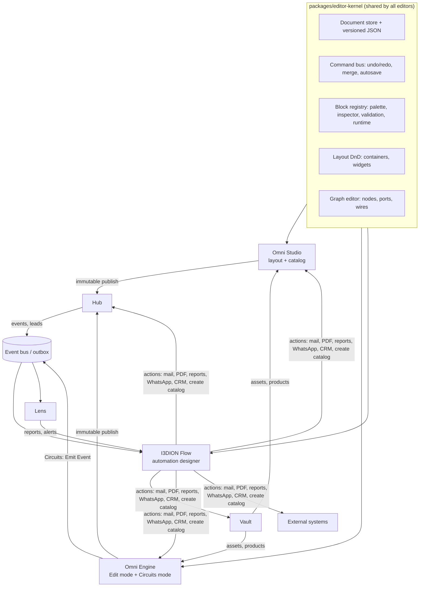
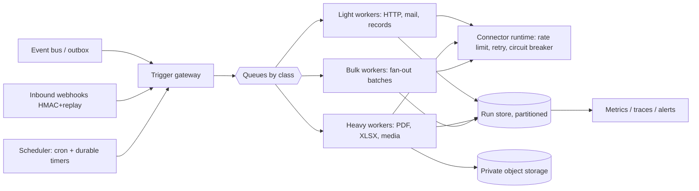

# I3DION Flow • Drag-and-Drop Framework • Omni Engine (Edit + Circuits) • Ecosystem
**Architecture v2.0 — 18 Oct 2026** • Labels: CONFIRMED / PROPOSED / UNKNOWN • Builds on `I3DION_Flow_Engine_Studio_Architecture.md` (this document supersedes its §4–§6 where they differ)

---

## 0. Why drag-and-drop "is not working" (diagnosis from your code, CONFIRMED)

| Where | What the code actually does | Consequence |
|---|---|---|
| **Studio palette → canvas** (`WidgetLibraryPanel`, `CanvasArea`) | Native HTML5 drag. The drop handler on `<main>` calls `addWidget(widgetType)` with **no target container, no position, no index** | Widgets always land in the same place; cannot drop into containers |
| **Moving existing widgets** | Only `moveWidget(id,'up'/'down')` buttons | No drag-to-reorder, no re-parenting |
| **Touch / keyboard** | Native HTML5 DnD has no touch support; no keyboard path | Unusable on tablets, not accessible |
| **Engine "Logic Puzzles" canvas** (`LogicPuzzlesCanvas.tsx`, 233 lines) | Only React state for category/search/zoom. **No pointer handlers, no drag, no wires** | It is a static picture, not an editor |
| **Engine viewport** (`EngineViewportCanvas.tsx`) | Gizmo "modes" are UI state only. **No TransformControls, keyframes, timeline or animation code found** | Move/rotate/scale/animate do nothing yet |
| **Engine persistence** (`useEngineStore`) | `saveCurrentProject` only flips an "autosave" status flag; no API call | Edits are not saved |
| **Studio Logic canvas** (`features/logic`) | Hand-built pointer drag and SVG paths (266 + 296 lines) | The only working graph, but it is a *third*, separate implementation: no port typing, no pan/zoom, no undo |
| **Libraries** | **No** drag-and-drop library and **no** graph library installed (only three / R3F / zustand / zod) | Every canvas is custom and inconsistent |

**Root cause:** three disconnected, hand-rolled canvases with no shared interaction model, plus Engine UI that is a façade with no runtime behind it. Fixing buttons one by one will not work. We need **one shared editor kernel**.

---

## 1. The ecosystem at a glance


**Rule:** products never call each other's internals. They (a) share **assets/products via Vault references**, (b) publish **immutable snapshots**, (c) communicate through **events** and **Flow connectors**.

---

## PART A — I3DION FLOW (standalone automation product)

### A1. Honest positioning
Power Automate has 1,000+ connectors and decades of engineering. **Do not chase parity.** Win on: (1) **deepest possible integration with the I3DION ecosystem** (no competitor can automate your 3D catalog, QR, AR leads), (2) a **great designer experience**, (3) **reliable, observable execution**, (4) **India-first connectors** (WhatsApp, Razorpay, Zoho, Tally-style exports), (5) a generic **HTTP / Webhook** connector, with Zapier/Make bridging for the long tail. Target ~25 first-class connectors, not 1,000.

### A2. Capability scope (what "complete top-level" means)

| Area | v1 (sellable) | v2 | v3 |
|---|---|---|---|
| **Triggers** | I3DION events, schedule (cron), inbound webhook, manual button, form submit, email received | File added (Drive/S3), polling triggers, Slack/Teams message | Custom connector triggers |
| **Control** | Condition (if/else), switch, for-each (with concurrency), do-until, parallel branches, delay / delay-until, scope with try/catch/finally, terminate, call sub-flow | Approval chains, human tasks with forms | Long-running sagas, compensation steps |
| **Data ops** | Variables, compose, parse JSON, filter/select/join arrays, format dates/numbers, lookup in Vault | Table/CSV/XLSX transforms, group/aggregate | AI extract/classify/summarise steps |
| **Communication** | Email (templated), in-app, WhatsApp template messages, SMS | Slack/Teams | Voice/IVR (only if asked) |
| **Documents** | **PDF generation** from templates (merge fields, repeating tables, branding, QR, 3D snapshot), **report generation** (query + template + schedule), CSV/XLSX export | Word (.docx) output, e-sign hook | Document parsing (OCR) |
| **Leads** | Create/update/dedupe/score/assign lead, status change, SLA timers, drip sequences (waits), alert owner | Round-robin & territory rules, enrichment | Predictive scoring |
| **Ecosystem actions** | Vault: get/update product, asset events • Studio: create catalog from template, export PDF • Engine: render snapshot, bake AR, publish scene • Hub: create QR/short link • Lens: run report, threshold alert • Core: invite user, plan-limit events | Bulk versions of all above | — |
| **Designer** | Drag-and-drop canvas, searchable palette, dynamic-content picker, expression editor, flow checker, test run, run history, versions, templates ("Recipes") | Visual diff, comments, folders, solutions (export/import), environments | Co-editing, AI "describe a flow" assistant |
| **Governance** | Tenant RBAC per flow, audit, run quotas, secrets vault, DLP connector policies | Approvals for risky actions, retention policies | SCIM, customer-managed keys |

### A3. Designer UX (the part users judge)
- **Layout:** left palette (search, categories, favourites) • centre canvas • right inspector • bottom panel with tabs **Test console / Run history / Flow checker**.
- **Interactions:** drag from palette or click "+" on any wire to insert a step; snap-to-grid; auto-layout button; mini-map; zoom/pan; multi-select (box + shift); copy/paste across flows; collapse a group into a **Scope**; keyboard shortcuts (Del, Ctrl+Z/Y, Ctrl+C/V, Ctrl+D, F to fit, / to search).
- **Dynamic content picker:** pick outputs of earlier steps as typed chips (like Power Automate); expression editor with autocomplete, inline errors, live preview using the last test payload.
- **Flow checker:** blocks publish on errors (missing connection, unmapped required field, unreachable step, loop without limit, risky bulk action without approval).
- **Testing:** (1) **Test with sample event** (side-effect steps stubbed, dry-run), (2) **Test with real data** (explicit confirmation), (3) **Re-run from failed step**, (4) per-step input/output inspector with PII masking, (5) test fixtures saved with the flow.
- **Run history:** timeline of steps, duration, retries, error, payload (masked), "Resubmit", "Cancel run".
- **Templates ("Recipes"):** 20+ ready recipes; every recipe is a normal editable flow.

### A4. Definition format & execution model
```
FlowDefinition v1 (JSON, versioned, zod-validated)
{ id, name, trigger{type, config, filter(expr)}, 
  variables[{name,type,default}], 
  graph{ nodes[{id,type,params,position,errorPolicy{retry,timeout,onError}}], 
         edges[{from,fromPort,to,toPort}] },
  settings{concurrency, runTimeout, retention, environment} }
compile(): graph → validated DAG (cycles only via explicit Do-Until/For-Each) → execution plan
```
- **Expressions:** a restricted, side-effect-free language (CEL/JSONata-style) with ~80 built-in functions (text, date, math, array, object, logic). **No JavaScript execution** in v1.
- **Custom code step:** only on Enterprise, later, running in an isolated sandbox (WASM / isolated-vm in a separate low-privilege container) with CPU/memory/time quotas and no network by default. PROPOSED; requires its own security review.
- **Step state machine:** `pending → running → succeeded | failed | skipped | waiting | cancelled`; the run state is **persisted after every step** (checkpointing) so a crashed worker resumes without repeating completed steps.

### A5. Massive-scale automation architecture


**Key mechanisms (all PROPOSED, to be validated by load tests):**
1. **Queue classes + priority lanes:** interactive (user-triggered, lead alerts) never wait behind bulk jobs.
2. **Per-tenant fairness:** token bucket per org + weighted round-robin dequeue so one customer's 100k-record run cannot starve others (noisy-neighbour protection).
3. **Fan-out / fan-in for bulk:** a For-Each over N items creates **chunked child runs** (e.g. 500 items/chunk) with a concurrency cap; parent tracks progress; partial-failure policy (continue / stop / threshold); resumable; large payloads passed as **object-storage references**, never inline (inline step payload cap, e.g. 256 KB).
4. **Exactly-once *effects* on at-least-once delivery:** every side-effect step gets an idempotency key `run_id:step_id`; connectors pass it downstream (email/payment providers) or dedupe in our DB (unique constraint).
5. **Durable timers:** `wait`/`delay-until` store `resume_at`; a scheduler claims due rows with `FOR UPDATE SKIP LOCKED`; flows can wait days without holding a worker.
6. **Backpressure & limits:** per-connector rate limits (provider quotas), circuit breaker on failing providers, queue-depth based throttling, 429 + `Retry-After` at the API, dead-letter queue with replay UI.
7. **Run store at scale:** monthly partitions for `flow_runs`/`flow_run_steps`; hot 30 days, then compress/archive to object storage; retention per plan.
8. **PDF/report pool:** headless Chromium (Playwright) workers in isolated containers; pooled pages, per-job timeout, memory cap, templates sanitised (no remote fetches except allow-listed assets); output to private storage with signed links.

**Scale stages (honest, to be proven):**
| Stage | Infra | Design target (PROPOSED) |
|---|---|---|
| **S-1** (pilots) | Postgres-backed queue (`graphile-worker`/`pg-boss`), 1–3 worker processes | ~50k runs/day, ≤ 10 runs/s sustained |
| **S-2** | Redis (BullMQ) or managed queue, autoscaled worker pools, partitioned run store | ~1M runs/day |
| **S-3** | Durable-execution engine (e.g. Temporal) or Kafka-class bus for multi-region | 10M+ runs/day |
Design so S-1 → S-2 only swaps the queue adapter (keep an internal `QueuePort` interface).
**SLO targets (validate by load test):** trigger → first step p95 < 5 s (interactive lane); single PDF p95 < 10 s; 1,000-PDF batch < 15 min with 20 workers.

### A6. Connector SDK
```
ConnectorManifest { id, name, auth{type: oauth2|apikey|basic|none}, 
  triggers[{id, schema, polling|webhook}], actions[{id, inputSchema, outputSchema, idempotent, rateLimit}],
  testFixtures }
```
Platform provides OAuth2 flow, token refresh, secret storage (envelope-encrypted), schema-driven UI forms, per-connector rate limiter, retry policy, and a **connector test harness**. First-party connectors: Vault, Studio, Engine, Hub, Lens, Core, Email, WhatsApp, SMS, HTTP, Webhook, Schedule, Google Sheets, Excel/CSV, Google Drive/S3, Slack, Teams, Zoho CRM, HubSpot, Razorpay.

### A7. Documents & communications engine
- **PDF templates:** HTML/CSS templates with merge fields, repeating table rows, headers/footers, page numbers, brand tokens, QR code, product images and **3D snapshot** (rendered by the Engine's snapshot service).
- **Reports:** saved query (Lens metrics / Vault tables) + template + schedule + recipients → PDF/XLSX attached or linked.
- **Email:** MJML templates, DKIM/SPF alignment, bounce/complaint handling, unsubscribe + suppression list, per-org sending limits; bulk sends over a threshold require approval (anti-abuse).
- **WhatsApp:** official Business Platform via a provider; only pre-approved templates outside the 24-hour window; opt-in tracking.

### A8. Security & compliance specifics
Tenant isolation (RLS + A4 authorization), per-flow RBAC (owner/editor/runner/viewer), secrets never returned or logged, SSRF-safe outbound HTTP, signed outbound webhooks and signed + replay-protected inbound webhooks, **DLP policies** (e.g. block "Vault asset → personal email" combinations), PII masking in run logs, run-data retention, audit of every publish/run-as, approval gates for high-risk actions, consent/unsubscribe handling (check applicable rules, e.g. India's DPDP Act and WhatsApp opt-in policy, with a legal advisor).

### A9. Metering & packaging (business)
Meter **runs** and **actions**, plus heavy units (PDF pages, emails). Enforce with atomic counters (Annex A11). Suggested Flow SKU ladder (PROPOSED): included runs per plan tier, add-on packs, enterprise custom. Show usage in-app.

---

## PART B — SHARED DRAG-AND-DROP & GRAPH FRAMEWORK (fixes Studio, Engine, Logic, Flow at once)

### B1. Package layout
```
packages/editor-kernel/        # framework-agnostic core
   document/  command-bus/  selection/  clipboard/  history/  schema/  autosave/
packages/layout-dnd/           # tree layout editor (Studio widgets, Engine UI editor)
packages/graph-editor/         # node/wire editor (Flow, Circuits, Studio logic)
packages/block-registry/       # BlockDef: one definition → palette + inspector + validation + runtime
```

### B2. Library decisions (PROPOSED; reversible behind adapters)
| Need | Choice | Why |
|---|---|---|
| Node/wire canvas | **React Flow (`@xyflow/react`)** (MIT) | Proven: custom nodes, typed handles, connection validation, minimap, zoom/pan, selection box, snap. Replaces three hand-built canvases |
| Tree/container drag-and-drop | **dnd-kit** (core + sortable + modifiers) | Pointer + touch + keyboard sensors, drag overlay, accessibility announcements, custom collision |
| Auto-layout | `elkjs` (or `dagre`) | Layered layout for flows/circuits |
| State | zustand + immer patches | Already in repo; patches give cheap undo/redo |
| 3D | React Three Fiber + drei (already installed) | `TransformControls`, `OrbitControls`, gizmos |
Alternative to evaluate in a 2-day spike: Atlassian *pragmatic-drag-and-drop* for the layout tree.

### B3. Block registry (single source of truth)
```ts
BlockDef {
  id, category, title, icon, version,
  ports: { in: Port[], out: Port[] },          // Port { id, kind: 'exec'|'data', type, multi, required }
  params: ZodSchema,                            // auto-generates the inspector form
  container?: { accepts: (childType)=>boolean, layout: 'stack'|'grid'|'free'|'tabs'|'repeater' },
  validate(node, doc): Issue[],
  run?(ctx, node): Result                        // runtime behaviour (Circuits / Flow executors)
}
```
Studio widgets, Engine chips, and Flow actions all register `BlockDef`s. Result: identical palette, search, inspector, validation, copy/paste, and undo behaviour everywhere.

### B4. Command bus (why edits never get lost)
Every user action is a **Command** `{type, do(doc), undo(doc), mergeKey?}` (InsertNode, MoveNode, DeleteNodes, SetParam, Connect, Disconnect, Group…). History stack with merge for continuous drags; autosave debounced with **optimistic-lock version** (409 → conflict dialog); the same commands later feed real-time collaboration (CRDT, PROPOSED v3).

### B5. Layout drag-and-drop algorithm (Studio containers & widgets)
```
document: tree of nodes { id, type, children[], layout{mode: stack|grid|free|tabs|repeater} }
onDragStart(source: paletteItem | existingNode):  lock selection; show DragOverlay (ghost)
onDragMove(pointer):
  candidates = droppable containers whose rect contains pointer       # dnd-kit collision (custom)
  target = deepest candidate where block.container.accepts(source.type) AND not isDescendant(source, candidate)
  if target.layout in (stack|tabs|grid):
        index = insertionIndex(pointer, target.children rects, axis)  # compare to child midpoints
        show insertion indicator (line / grid cell outline)
  if target.layout == free:  position = snap(pointer - dragOffset, grid=8px, guides=sibling edges/centres)
  autoScroll(nearest scrollable) when pointer within 40px of edge
onDrop: dispatch InsertNode or MoveNode(target, index|position)   # one undoable command
rules:  cannot drop a node into itself/descendants • container capacity limits • Alt = duplicate • Shift = constrain axis
        multi-select drags together • touch: long-press to pick up • keyboard: Space to lift, arrows to move, Space to drop
performance: virtualise long lists; keep drag overlay outside React tree updates; ≥ 60 fps with 500 nodes
```
**Studio layout modes:** Stack (flex), Grid, **Free canvas** (absolute positioning, snapping, alignment guides, resize handles), Tabs, Carousel, **Repeater** (data-bound from Vault). Containers declare `accepts` rules (e.g. a Product Card accepts Image, Title, Price, 3D Viewer, Button).

### B6. Graph editor behaviours (Flow, Circuits, Studio logic)
- Palette → canvas via drag overlay; drop position = `screenToFlowPosition(pointer)`; double-click canvas = quick-add search; drag from an output handle onto empty canvas opens "add connected node".
- **Typed ports:** `exec` (control flow) vs `data` (typed values). `isValidConnection` rules: exec→exec only; data types must match or have a defined coercion (number→string ok; string→number needs a Convert chip); one wire per input port; outputs may fan out (data) — exec outputs connect to one target unless a Parallel chip is used. Incompatible drops show a reason tooltip.
- **Cycle detection:** reject wires that create a cycle unless the target is a Loop/Do-Until chip.
- Auto-layout, align/distribute, group into a Module/Scope (collapsible), comments/sticky notes, copy/paste with ID remap, search-and-focus (Ctrl+F), minimap, fit view, snap-to-grid, wire re-routing handles, delete-on-select.
- **Scale:** render only visible nodes; collapsed groups; tested with 1,000 nodes.
- **Accessibility:** keyboard navigation between nodes and ports, "connect with keyboard" mode, ARIA labels, reduced-motion support.

### B7. Definition of "working" (tests)
Playwright suite with **mouse, touch emulation and keyboard** for every scenario: drop at index, nest into container, reject invalid nesting, reorder, duplicate, undo/redo ×10, save-reload equality, connect/disconnect wires, type-mismatch rejection, cycle rejection, multi-select drag, 500-node performance budget.

---

## PART C — OMNI ENGINE: two workspaces

### C0. Naming (replacing "Verge3D puzzles") — PROPOSED, owner may change
| Old / Verge3D term | I3DION name |
|---|---|
| Puzzles | **Chips** |
| Puzzle editor | **Circuit Board** |
| A set of puzzles | **Circuit** |
| Procedures (reusable groups) | **Modules** |
| Logic mode | **Circuits mode** |
| Basic editing mode | **Edit mode** |
Public wording: "Omni Circuits — visual interactivity for 3D." Avoid "puzzle" and "Verge3D" in UI, docs and marketing.

### C1. Section 1 — EDIT MODE (3D scene editing)
Built on React Three Fiber + drei, writing to the non-destructive **Scene Document** (see previous architecture §4.1). Every change is a Command.

| Feature | Implementation |
|---|---|
| Select (click, box, outliner, multi) | Raycast + outline highlight; hierarchy tree with drag-to-reparent (uses `layout-dnd`) |
| **Move / Rotate / Scale** | drei `TransformControls`; local/world space; snapping (grid, angle, scale step); numeric X/Y/Z fields with units; reset/apply |
| **Pivot** | Pivot offset override; snap pivot to bounds centre/base |
| **Collections** | Named sets of nodes (colour tag, visibility, selectable, lock) — the base for Circuits |
| **Keyframes & animation** | Timeline panel: tracks per node + property (position/rotation/scale/colour/opacity/visibility/camera); **auto-key**; dope-sheet and curve editor (Bezier handles, easing presets); scrub, loop, play range, speed; multiple named **Clips**; import existing glTF clips |
| **Textures & materials** | Material slots per mesh; PBR parameters; texture slots (base colour, normal, roughness, metallic, emissive, opacity); UV tiling/offset/rotation; texture upload via Vault pipeline; material library; per-part swap |
| **Camera** | Multiple cameras; perspective/orthographic; FOV, near/far; **saved Views (bookmarks)**; fly-to; camera keyframes; orbit limits for viewers; view cube; Frame Selected (F) / Frame All (Home) |
| **Lights & environment** | HDRI, intensity, shadow toggles, ground/contact shadow |
| **View modes** | Shaded, wireframe, X-ray, bounding boxes, stats overlay (triangles, draw calls, texture MB) |
| **Persistence** | Real API: `PUT /scenes/:id` with version check; autosave status must reflect actual server result (fixes the fake "saved" flag) |
| **Budgets** | Live warnings: model size, texture memory, draw calls, for mobile profile |

### C2. Section 2 — CIRCUITS MODE (logic on collections)
- **UI:** Circuit Board (graph editor from `graph-editor`), chip palette with search, collections panel, variables panel, Modules, debug panel, **Run / Stop** toggle that runs the circuit live in the viewport.
- **Collection-centric chips** (the key idea): *On Collection Click/Hover*, *For Each in Collection*, *Pick Random / Nearest / First*, *Filter by Tag*, *Count*, *Set Collection Property*, *Play Animation on Collection*.
- **Chip catalog (v1, ~70 chips):**
  - **Events:** Scene Loaded, Click, Hover, Pointer Down/Up, Drag, Key Press, Timer, Animation Finished, Variable Changed, Collection Click, Hotspot Opened, Camera Reached View, AR Session Start/End, Variant Changed.
  - **Flow control:** Sequence, Branch (If/Else), Switch, Loop, While (capped), Delay, Parallel, Do Once, Gate, Break.
  - **Variables & math:** Set/Get Variable, Increment, Toggle, Random, Compare, AND/OR/NOT, Math, Clamp, Lerp, Format Text.
  - **Transform:** Move/Rotate/Scale (to/by, duration, easing), Look At, Attach/Detach, Reset Transform.
  - **Appearance:** Set Colour, Swap Material, Swap Texture, Set Opacity, Show/Hide, Highlight, Outline.
  - **Animation:** Play/Pause/Stop Clip, Seek, Set Speed, Play Keyframe Track, Explode/Assemble.
  - **Camera:** Go To View, Orbit To, Follow, Lock/Unlock Controls, FOV.
  - **UI & sound:** Show Card/Toast, Open Hotspot, Play Sound, Show Spec Table.
  - **Data:** Read Product Field (Vault), Set Price Display, Call Variant.
  - **Business:** **Submit Lead**, **Request Quote**, **Open WhatsApp**, **Track Event** (to Lens), **Emit Flow Event**, Open URL (allow-listed).
  - **Modules:** Call Module, Module Input/Output.
- **Compile & execute:** graph → versioned **Circuit IR** (validated) → interpreter in `viewer-3d` runtime (same code in editor, Hub, AR). Event loop with a frame-sliced scheduler; delays/tweens via a timeline service; variables in a typed store.
- **Safety:** per-event step cap (e.g. 200), per-frame time slice, loop iteration cap, no `eval`, URL allow-list, typed data only; infinite-loop protection reports the offending chip.
- **Debugging:** wire highlighting as events flow, breakpoints on chips, step-through, variable watch, event log, "record & replay" of an interaction session.
- **Testing:** golden-run tests (recorded event sequence → expected scene state), IR schema tests, fuzzing of malformed graphs.

---

## PART D — ECOSYSTEM CONNECTIVITY

### D1. Contracts (extend `packages/contracts`)
`identity` • `assetRef` • `catalogComposition` • `experienceScene` • `circuitIR` (new) • `flowDefinition` (new) • `event` (extend) • `lead` • `publishing`. Versioned, backward compatible, validated at every boundary.

### D2. Event catalog (domain events; each is also a Flow trigger)
`asset.version_uploaded/approved` • `product.updated` • `catalog.published/unpublished` • `scene.published` • `ar.bake_completed` • `hub.visit` • `hub.qr_attributed_visit` • `engine.circuit_event` (Emit Flow Event chip) • `lead.created/status_changed/sla_breached` • `quote.requested` • `report.generated` • `payment.failed` • `plan.limit_reached` • `user.invited`.

### D3. Flow connector per product (actions)
| Product | Triggers | Actions |
|---|---|---|
| **Vault** | asset/version uploaded, product updated | Get/update product, request approval, tag asset, create collection |
| **Studio** | catalog published | Create catalog from template, add product to catalog, export catalog PDF |
| **Engine** | scene published, bake done | Render snapshot/thumbnail, bake AR (GLB/USDZ), publish scene |
| **Hub** | visit threshold, QR visit, lead created, quote requested | Create QR/short link, update visibility, add comment |
| **Lens** | metric threshold, report ready | Run report, export XLSX/PDF, create alert |
| **Core** | plan limit, user invited | Invite user, change role (approval-gated) |

### D4. Flagship mega-automation (the demo that sells it)
> **"Trade-show kit in one click":** *New product uploaded to Vault* → Flow: validate required fields → **Studio** creates a catalog page from template → **Engine** renders a snapshot and bakes AR → **Hub** publishes and creates the QR → **PDF** spec sheet generated with the QR and 3D snapshot → **email + WhatsApp** to the dealer list (approval if > 200 recipients) → visits and leads captured → **lead.created** → assign by region, WhatsApp the owner, 24-h SLA timer → weekly **Lens report PDF** emailed to the sales manager.

### D5. Shared experience layer
One login and org switcher • app launcher with Flow tile • **unified notification and approvals centre** • command palette searching across Vault/Studio/Engine/Flow/Lens • one design system • "Use in Flow" button on assets, catalogs, scenes, leads • Lens shows Flow health (runs, failures, time saved).

### D6. What NOT to build (scope protection)
Mesh modelling or parametric CAD • 1,000 connectors • a general-purpose scripting language (before pilots) • real-time co-editing (before pilots) • a marketplace (before pilots) • a second graph editor (use the kernel).

---

## PART E — Risks & decisions
| ID | Risk / decision | Recommendation |
|---|---|---|
| R-1 | Scope: Flow alone is a product-sized effort | Build Flow v1 narrowly (A2 v1 column); Flow is a separate SKU/pricing line |
| R-2 | Rewriting three canvases breaks existing screens | Strangler approach: build kernel + adapters, migrate one editor at a time behind feature flags |
| R-3 | PDF rendering is memory-heavy and a security surface | Isolated worker pool, template sanitising, strict timeouts |
| R-4 | WhatsApp/email compliance | Opt-in, templates, suppression lists, legal review |
| R-5 | Scale claims | Publish only measured numbers after load tests |
| D-16 | Names: Chips / Circuit Board / Circuits | Approve or choose alternatives |
| D-17 | React Flow + dnd-kit adoption | Approve after a 2-day spike |
| D-18 | Flow as separately priced SKU | Yes |
| D-19 | Queue technology for stage S-1 | `graphile-worker`/`pg-boss` on Postgres |
