# I3DION Flow — Phase 0: Repository Audit, Feature Matrix & Architecture Decisions
**Date:** 18 October 2026 • **Status:** PHASE 0 COMPLETED (GATE AWAITING OWNER APPROVAL) • **Author:** Antigravity (Principal Platform Architect & Lead Security Engineer)  
**Truth Labels:** CONFIRMED (Verified against code/tests/DB) | PROPOSED (Architecture recommendation) | UNKNOWN (Awaiting inspection) | CONFLICT (Contradiction identified)

---

## 1. Executive Summary & Product-Boundary Conflict

### 1.1 The Core Product-Boundary Conflict
- **Ecosystem Master Doc v2 (`docs/I3DION_Company_Ecosystem_Master_Documentation_v2.md`):** Lists strictly **five canonical products** in established order:
  1. I3DION Spatial Hub
  2. I3DION Spatial Vault
  3. I3DION Omni Studio
  4. I3DION Spatial Engine
  5. I3DION Spatial Lens
  *Flow is not listed as a standalone product in the ecosystem baseline, but referenced in `I3DION_Flow_Engine_Studio_Architecture.md` as an internal shared automation layer / event outbox.*
- **Owner Directive (Master Prompt v2.0 & Audio Directive):** Flow is to be elevated to a **full, standalone visual low-code workflow automation platform** (category: Microsoft Power Automate for 3D/Spatial Industrial Commerce), complete with a first-class drag-and-drop designer, multi-step pipeline runner, connectors, email/lead automation, and document generation.
- **Resolution (CONFLICT-01):**
  - **Proposed Ecosystem Update:** Formally expand the I3DION product roster to 6 products: **Hub → Vault → Omni Studio → Spatial Engine → I3DION Flow → Spatial Lens**, with Flow owning workflow definitions, immutable versions, triggers, execution run states, schedules, approvals, and connector execution.
  - **Status:** **OWNER APPROVAL REQUIRED** (Decision D-F01). No canonical documents will be silently modified until this decision is formally ratified.

---

## 2. Ground-Truth Repository Audit

### 2.1 Technology Stack & Frameworks
| Layer | Technology | Version | Location / Verification |
|---|---|---|---|
| **Frontend Runtime** | React | `^19.0.0` | [frontend/package.json](file:///d:/I3DION%20COMPANY%20FILES/i3dion-spatial/I3DION_Spatial/frontend/package.json#L26) |
| **Frontend Build** | Vite | `^6.1.0` | [frontend/package.json](file:///d:/I3DION%20COMPANY%20FILES/i3dion-spatial/I3DION_Spatial/frontend/package.json#L54) |
| **Styling & Icons** | Tailwind CSS + Lucide React | `3.4.17` / `0.475.0` | [frontend/package.json](file:///d:/I3DION%20COMPANY%20FILES/i3dion-spatial/I3DION_Spatial/frontend/package.json#L24) |
| **Animation** | Framer Motion | `^12.0.6` | [frontend/package.json](file:///d:/I3DION%20COMPANY%20FILES/i3dion-spatial/I3DION_Spatial/frontend/package.json#L23) |
| **3D Rendering** | Three.js + React Three Fiber + Drei | `0.174.0` / `9.0.0` / `10.7.7` | [frontend/package.json](file:///d:/I3DION%20COMPANY%20FILES/i3dion-spatial/I3DION_Spatial/frontend/package.json#L17-L19) |
| **Backend Runtime** | Node.js (ESM) | `v24.18.0` | [backend/package.json](file:///d:/I3DION%20COMPANY%20FILES/i3dion-spatial/I3DION_Spatial/backend/package.json#L5) |
| **Backend Framework**| Express | `^4.21.2` | [backend/package.json](file:///d:/I3DION%20COMPANY%20FILES/i3dion-spatial/I3DION_Spatial/backend/package.json#L19) |
| **Database Driver** | PostgreSQL (`pg`) with Connection Pool | `^8.13.1` | [backend/src/db/pool.js](file:///d:/I3DION%20COMPANY%20FILES/i3dion-spatial/I3DION_Spatial/backend/src/db/pool.js) |
| **Validation** | Zod | `^3.24.2` | Shared across frontend, backend, packages |
| **State Management**| Zustand | `^5.0.3` | [frontend/src/store/](file:///d:/I3DION%20COMPANY%20FILES/i3dion-spatial/I3DION_Spatial/frontend/src/store/) |
| **Graph / Canvas** | **NONE installed** (Hand-rolled SVG/pointer only) | N/A | **CONFIRMED GAP**: No `@xyflow/react` or `@dnd-kit` installed |
| **Queue / Workers** | **NONE installed** (In-process DB queries only) | N/A | **CONFIRMED GAP**: No `pg-boss`, `graphile-worker`, or `BullMQ` |

### 2.2 Database & Schema Verification (Live PostgreSQL Audit)
Querying `information_schema.tables` confirmed 73 tables exist in the PostgreSQL database. Specifically for Flow & Automation:
1. `flows` table: **CONFIRMED PRESENT** in [backend/src/db/pool.js:L582](file:///d:/I3DION%20COMPANY%20FILES/i3dion-spatial/I3DION_Spatial/backend/src/db/pool.js#L582). Columns: `id` (uuid), `organization_id` (uuid), `name` (text), `description` (text), `trigger_type` (text), `trigger_config` (jsonb), `steps` (jsonb), `status` (text), `created_at`, `updated_at`.
2. `flow_runs` table: **CONFIRMED PRESENT** in [backend/src/db/pool.js:L595](file:///d:/I3DION%20COMPANY%20FILES/i3dion-spatial/I3DION_Spatial/backend/src/db/pool.js#L595). Columns: `id`, `flow_id`, `organization_id`, `status`, `trigger_payload` (jsonb), `step_results` (jsonb), `error`, `started_at`, `completed_at`.
3. `flow_event_outbox` table: **CONFIRMED PRESENT** in [backend/src/db/pool.js:L607](file:///d:/I3DION%20COMPANY%20FILES/i3dion-spatial/I3DION_Spatial/backend/src/db/pool.js#L607). Columns: `id`, `organization_id`, `event_type`, `payload` (jsonb), `status`, `created_at`, `processed_at`.
4. `automation_rules` table: **CONFIRMED PRESENT** in [backend/src/db/schema.sql:L548](file:///d:/I3DION%20COMPANY%20FILES/i3dion-spatial/I3DION_Spatial/backend/src/db/schema.sql#L548). Columns: `id`, `organization_id`, `name`, `event_type`, `conditions` (jsonb), `audience_roles`, `channel`, `is_active`.
5. `integrations` table: **CONFIRMED PRESENT** in [backend/src/db/schema.sql:L337](file:///d:/I3DION%20COMPANY%20FILES/i3dion-spatial/I3DION_Spatial/backend/src/db/schema.sql#L337). Columns: `id`, `organization_id`, `provider`, `status`, `config` (jsonb), `secrets_ref` (text), `last_sync_at`.
6. `leads` table: **CONFIRMED PRESENT** in [backend/src/db/schema.sql:L280](file:///d:/I3DION%20COMPANY%20FILES/i3dion-spatial/I3DION_Spatial/backend/src/db/schema.sql#L280) and contract [packages/contracts/src/lead.ts](file:///d:/I3DION%20COMPANY%20FILES/i3dion-spatial/I3DION_Spatial/packages/contracts/src/lead.ts). Acts as the ecosystem's canonical lead system of record.
7. `notifications` table: **CONFIRMED PRESENT** in [backend/src/db/schema.sql:L315](file:///d:/I3DION%20COMPANY%20FILES/i3dion-spatial/I3DION_Spatial/backend/src/db/schema.sql#L315).

### 2.3 Existing Flow Services & Code Paths
- **`backend/src/services/flow/flowEngine.js`**: **CONFIRMED**. Implements `executeFlowRules({ organizationId, eventType, payload })`. Used directly by `hubService.js` (line 343) for inbound lead submission (`lead_form_submitted`).
- **`backend/src/services/emailService.js`**: **CONFIRMED**. Implements `EmailProvider` with `nodemailer` (SMTP or local console fallback in development) and branded HTML templates.
- **`backend/src/routes/studio.js:L790`**: **CONFIRMED**. `GET /catalogs/:id/export/pdf` calls `catalogService.generatePdfSpecSheet` returning print-ready HTML/PDF specifications.
- **Frontend Flow Prototype**: **CONFIRMED**. [FlowPage.tsx](file:///d:/I3DION%20COMPANY%20FILES/i3dion-spatial/I3DION_Spatial/frontend/src/pages/flow/FlowPage.tsx) at `/flows` with preset templates, visual pipeline connector cards, and interactive test simulation.
- **Missing in Backend**: `backend/src/server.js` does NOT currently mount `/api/flows` endpoints, and `flowExecutor.js` was previously unwritten on disk.

---

## 3. Current Feature Matrix (Audit Findings)

| Capability / Component | Status | Codebase Location | Gap / Action Needed |
|---|---|---|---|
| **App Launcher Drawer** | **CONFIRMED ACTIVE** | [AppLauncher.tsx](file:///d:/I3DION%20COMPANY%20FILES/i3dion-spatial/I3DION_Spatial/frontend/src/components/AppLauncher.tsx) | Right-to-left slide-over drawer, Emerald Vault, Flow in launcher |
| **Flow Route & Entitlements** | **CONFIRMED ACTIVE** | [App.tsx](file:///d:/I3DION%20COMPANY%20FILES/i3dion-spatial/I3DION_Spatial/frontend/src/App.tsx#L270), [licenseStore.ts](file:///d:/I3DION%20COMPANY%20FILES/i3dion-spatial/I3DION_Spatial/frontend/src/store/licenseStore.ts#L5) | Accessible at `/flows`, guarded by `flow` license tier |
| **Flow Web UI Canvas** | **PARTIAL PROTOTYPE** | [FlowPage.tsx](file:///d:/I3DION%20COMPANY%20FILES/i3dion-spatial/I3DION_Spatial/frontend/src/pages/flow/FlowPage.tsx) | Card pipeline with test runner; lacks true 2D free node-and-wire drag/drop |
| **Graph Editor Library** | **ABSENT** | N/A | Need to install `@xyflow/react` (MIT) or build modular node-wire kernel |
| **Flow Definition Zod Contract** | **ABSENT** | N/A | Need `FlowDefinitionSchema v1.0` in `packages/contracts/src/flow.ts` |
| **Flow REST Endpoints** | **ABSENT** | [backend/src/routes/flow.js](file:///d:/I3DION%20COMPANY%20FILES/i3dion-spatial/I3DION_Spatial/backend/src/routes/flow.js) | Route file needs creation and mounting in `backend/src/server.js` |
| **Flow Execution Engine** | **BASIC RULES ONLY** | [flowEngine.js](file:///d:/I3DION%20COMPANY%20FILES/i3dion-spatial/I3DION_Spatial/backend/src/services/flow/flowEngine.js) | Only matches `automation_rules`; needs node-by-node graph executor with checkpointing |
| **Event Outbox Table** | **CONFIRMED IN DB** | [pool.js:L607](file:///d:/I3DION%20COMPANY%20FILES/i3dion-spatial/I3DION_Spatial/backend/src/db/pool.js#L607) | Table exists; needs durable dispatcher worker |
| **Email Delivery** | **CONFIRMED** | [emailService.js](file:///d:/I3DION%20COMPANY%20FILES/i3dion-spatial/I3DION_Spatial/backend/src/services/emailService.js) | Working nodemailer + dev fallback; needs consent/suppression check |
| **Lead Canonical Model** | **CONFIRMED** | [lead.ts](file:///d:/I3DION%20COMPANY%20FILES/i3dion-spatial/I3DION_Spatial/packages/contracts/src/lead.ts) + `leads` table | Complete lead schema with consent, intent, status, assignment |
| **Document/Catalog Job** | **CONFIRMED (Studio)** | [catalogService.js:L483](file:///d:/I3DION%20COMPANY%20FILES/i3dion-spatial/I3DION_Spatial/backend/src/services/studio/catalogService.js#L483) | Studio generates branded HTML/PDF; needs Flow action adapter |
| **Multi-Tenant RLS & Auth** | **CONFIRMED** | [pool.js:L635](file:///d:/I3DION%20COMPANY%20FILES/i3dion-spatial/I3DION_Spatial/backend/src/db/pool.js#L635), [auth.js](file:///d:/I3DION%20COMPANY%20FILES/i3dion-spatial/I3DION_Spatial/backend/src/routes/auth.js) | Strict `withTenant(orgId, ...)` and JWT auth middleware |

---

## 4. Ecosystem Boundary Map

```mermaid
flowchart TD
  subgraph HUB["1. I3DION Spatial Hub"]
    H_PUB[Public Showcase & QR Pages]
    H_EVT[Emits: lead_form_submitted, 3d_interaction]
  end

  subgraph VAULT["2. I3DION Spatial Vault"]
    V_ASSETS[3D Models, STEP, GLB, USDZ]
    V_DATA[Enterprise Catalog & Product Records]
    V_EVT[Emits: asset_version_published]
  end

  subgraph STUDIO["3. I3DION Omni Studio"]
    S_CAT[Catalog Composer & Spec Sheets]
    S_EXP[PDF Specification Generator]
    S_JOB[Catalog Batch Jobs]
  end

  subgraph ENGINE["4. I3DION Spatial Engine"]
    E_3D[3D Interactive Scene Runtime]
    E_CIRC[Omni Circuits / Hotspots]
    E_EVT[Emits: spatial.circuit.trigger]
  end

  subgraph FLOW["5. I3DION Flow (NEW STANDALONE PRODUCT)"]
    F_DSGN[Drag-and-Drop Workflow Canvas]
    F_SCHEM[Versioned Flow Definitions & Typed Action Registry]
    F_RUN[Deterministic Execution Engine & Checkpointing]
    F_CONN[Connections & Credentials Store]
    F_OUTBOX[Transactional Event Outbox]
  end

  subgraph LENS["6. I3DION Spatial Lens"]
    L_ANL[Analytics & BI Dashboards]
    L_ALRT[Threshold Alerts]
  end

  %% Interactions
  H_EVT -->|Event Bus / Webhook| F_OUTBOX
  V_EVT -->|Event Bus| F_OUTBOX
  E_EVT -->|Event Bus| F_OUTBOX
  L_ALRT -->|Event Bus| F_OUTBOX

  F_RUN -->|Send Email| EXT_MAIL[Nodemailer / SMTP]
  F_RUN -->|Route / Score Lead| VAULT
  F_RUN -->|Start Catalog Job| STUDIO
  F_RUN -->|Dispatch Outbound Webhook| EXT_CRM[CRM / ERP / Webhook]
  F_RUN -->|Emit Telemetry| LENS
```



---

## 5. Conflict & Decision Register

| ID | Topic | Current State / Conflict | Proposed Resolution | Decision Owner |
|---|---|---|---|---|
| **D-F01** | **Product Portfolio Expansion** | Ecosystem Master Doc v2 lists 5 products; owner requests Flow as 6th standalone product | Ratify I3DION Flow as 6th official product. Retain canonical order: Hub → Vault → Studio → Engine → Flow → Lens. | Product Owner |
| **D-F02** | **Designer Canvas Implementation** | React Flow (`@xyflow/react`) vs Hand-Rolled Canvas | **Recommend `@xyflow/react` (MIT)** for React 19 compatibility, custom SVG ports, minimap, pan/zoom, keyboard nav, and high FPS with 500+ nodes. | Engineering Lead / Owner |
| **D-F03** | **Execution Architecture** | Immediate in-process execution vs durable queue worker (`pg-boss` / `graphile-worker`) | **Phase 1-4 MVP: In-process transactional runner** with step checkpointing in PostgreSQL `flow_runs`. **Phase 7: Introduce `pg-boss`** (Postgres-backed queue) for background retries and cron. | Architect / Owner |
| **D-F04** | **Expression Language Engine** | Freeform JavaScript vs Restricted JSONLogic / Safe Evaluator | **Strictly NO arbitrary JS execution**. Use safe, typed expression evaluator (e.g., JSONLogic / CEL) for string templates, boolean logic, and numeric comparison. | Security Lead |
| **D-F05** | **Lead System of Record** | Vault product enquiries vs dedicated `leads` table | The canonical `leads` table ([schema.sql:L280](file:///d:/I3DION%20COMPANY%20FILES/i3dion-spatial/I3DION_Spatial/backend/src/db/schema.sql#L280)) is the system of record. Flow reads/updates `leads` through authorized contracts. | Product Owner |
| **D-F06** | **Live Email Authorization** | Unrestricted sending vs Guarded Test Mode | Development environments default to Console Fallback and explicitly allowlisted recipient testing. Live bulk sends require Owner approval gate. | Security Lead / Owner |

---

## 6. Threat Model & Security Controls

| Threat | Attack Vector | Security Safeguard & Mitigation |
|---|---|---|
| **SSRF (Server-Side Request Forgery)** | User configures HTTP Action / Webhook to fetch internal cloud metadata (`169.254.169.254`) or localhost (`127.0.0.1`, `10.0.0.0/8`). | Outbound HTTP connector strictly blocks RFC1918 private ranges, loopback, and link-local endpoints. Only allows validated public HTTPS URLs. |
| **Cross-Tenant Data Leakage** | Malicious tenant executes or reads flow definitions, runs, or credentials of another organization. | Every database access is wrapped in `withTenant(req.user.organization_id)` with multi-tenant row-level isolation and strict ownership checks in SQL queries. |
| **Arbitrary Code Execution** | Attacker injects JavaScript into flow nodes, variables, or expressions to compromise server. | No `eval()`, no `new Function()`, no dynamic JS interpretation. All node behaviors are hardcoded typed action handlers. Expressions use pure functional AST evaluation. |
| **Credential / Secret Disclosure** | API tokens or SMTP passwords stored in flow JSON are leaked via client UI or execution logs. | Flow definitions store only `connection_id` references. Credentials reside encrypted in `integrations.secrets_ref`. Step output logs automatically redact fields matching secret/token patterns. |
| **Denial of Service / Infinite Recursion** | Flow trigger fires a webhook that triggers itself in an infinite cascade loop. | Enforce run hop counter (`max_depth = 5`). Enforce concurrency limit per organization (e.g. max 5 concurrent runs) and per-step timeout (default 30s). |
| **Webhook Spoofing & Replay** | Attacker replays intercepted webhook payloads to create fraudulent leads or runs. | Webhooks enforce HMAC-SHA256 signature verification with constant-time length-safe compare and a 5-minute replay window timestamp check. |

---

## 7. MVP PRD (Product Requirements Document)

### 7.1 Target Persona & Problem Statement
- **Persona:** Industrial Sales Engineers, Technical Marketing Managers, and B2B Operations Teams.
- **Problem:** Customers visiting 3D catalogs or scanning QR codes on machinery generate high-intent engagement (dwell time, exploded-view inspection, RFQ requests), but follow-up is manual, slow, and disconnected from CRM systems.
- **Solution:** I3DION Flow enables low-code visual automation that listens to 3D spatial events, scores engagement, auto-generates branded quotation emails, and synchronizes leads to internal teams and external CRMs.

### 7.2 MVP Scope (Sellable Phase 1-4 Deliverable)
1. **Visual Drag-and-Drop Designer:**
   - Visual canvas with grid, pan/zoom, and node minimap.
   - Node catalog sidebar (Triggers, Logic, Communication, Ecosystem, Data).
   - Drag from palette onto canvas; drag-and-drop between nodes; wire connectors with type-safe ports.
   - Node Inspector panel for configuring properties, static values, or dynamic variable mapping.
2. **Deterministic Execution Engine:**
   - Real backend runner in Node.js executing step-by-step DAGs.
   - Step checkpointing in `flow_runs` (status, inputs, outputs, duration, errors).
   - Test Run Runner: executes flow with sample payload and streams live step-by-step telemetry.
3. **Core Node Catalog (12 Executable MVP Nodes):**
   - *Triggers:* Manual Test Button, Inbound Webhook, I3DION Event (`lead_form_submitted`, `3d_interaction`).
   - *Logic:* Condition (If/Else with AND/OR), Delay/Wait (seconds), Terminate.
   - *Data:* Compose / Template Transform, Set Variable.
   - *Communication:* Send Email (templated, with fallback logger), In-App Notification.
   - *Ecosystem:* Lead Auto-Assign, Outbox Dispatch.
4. **Starter Templates ("Recipes"):**
   - Recipe 1: *Customer RFQ & Auto-Mail Proposal Generation*.
   - Recipe 2: *3D High-Dwell Lead Scoring & Owner Alert*.
   - Recipe 3: *AI Component Cross-Sell & Notification*.

---

## 8. Designer Interaction Specification

### 8.1 Visual Designer Layout (Desktop & Responsive)
- **Top Command Bar:** Flow Title (inline editable), Save State Badge (`Saved` / `Unsaved Changes` / `Saving...`), Validate Button, Test Run Button, Publish Toggle.
- **Left Palette (Width: 280px):** Searchable accordion of categorized nodes (Triggers, Logic, Communication, Data, Ecosystem). Drag handles with preview ghost.
- **Center Canvas:** Infinite pannable/zoomable canvas (dots grid, snap-to-grid 8px). Node cards with color-coded category headers, status badges, input/output connection handles.
- **Right Inspector (Width: 340px):** Appears when a node is selected. Dynamic form generated from node schema. Dynamic variable picker button (`{x}`) next to string/number inputs.
- **Bottom Telemetry Drawer (Collapsible):** Displays live test execution output, step timing (ms), payload inspector, and validation error links.

### 8.2 Keyboard Accessibility & Affordances
- <kbd>Space</kbd> + Drag: Pan canvas.
- <kbd>Ctrl</kbd> + <kbd>Z</kbd> / <kbd>Ctrl</kbd> + <kbd>Y</kbd>: Undo / Redo graph mutations.
- <kbd>Delete</kbd> / <kbd>Backspace</kbd>: Delete selected node or wire (with confirmation if connected).
- <kbd>F</kbd>: Fit to view (zoom to fit all nodes).
- <kbd>Esc</kbd>: Deselect node / close inspector.
- Tab navigation across node ports for keyboard-only connection authoring.

---

## 9. Workflow Schema & Action Registry Proposal

### 9.1 Flow Definition Schema (Draft)
```ts
export interface FlowDefinition {
  id: string;
  schemaVersion: '1.0';
  organizationId: string;
  name: string;
  description?: string;
  status: 'draft' | 'published' | 'paused' | 'archived';
  version: number;
  trigger: {
    id: string;
    type: 'manual' | 'webhook' | 'event' | 'schedule';
    config: Record<string, unknown>;
  };
  nodes: {
    id: string;
    type: string; // e.g. 'condition', 'send_email', 'auto_assign_lead'
    label: string;
    position: { x: number; y: number };
    params: Record<string, unknown>;
  }[];
  edges: {
    id: string;
    sourceNodeId: string;
    sourcePort: string; // 'out', 'true', 'false'
    targetNodeId: string;
    targetPort: string; // 'in'
  }[];
  variables?: { name: string; type: 'string' | 'number' | 'boolean'; default?: unknown }[];
  settings?: { concurrency: number; timeoutSeconds: number };
  createdAt: string;
  updatedAt: string;
}
```

---

## 10. Phased Implementation Roadmap

- **Phase 0 (Current):** Repository Audit, Decisions & PRD Baseline $\rightarrow$ **Gate: Owner Approval**.
- **Phase 1 (Specification):** Detailed Contracts, Zod Schemas, Action Registry, and Test Fixtures.
- **Phase 2 (Persistence & API):** Backend Flow CRUD, Versioning, and RLS Negative Test Suite.
- **Phase 3 (Visual Designer):** React Flow drag-and-drop canvas, variable picker, and inspector forms.
- **Phase 4 (Execution Engine):** Step-by-step DAG runner, checkpointing, and deterministic test simulator.
- **Phase 5 (Email & Leads):** Email provider integration, suppression rules, and canonical lead pipeline.
- **Phase 6 (Documents & Catalogs):** Branded PDF quotation generation and Omni Studio catalog batch triggers.
- **Phase 7 (Scheduler & Connectors):** Cron scheduler, webhook security gateway, and connector framework.
- **Phase 8 (Production Readiness):** E2E Playwright tests, load test (100 concurrent runs), security review, and release.

---

## 11. Acceptance Tests (Phase 0 Baseline)

1. `test-security-s0.js`: **PASSED (7/7)** — C1 platform staff allowlist, C2 server-side billing order authority, C3 transactional signup, SEC-01 secrets inventory, H5 hashed reset tokens, H3 rate limiters, H4 webhook HMAC.
2. `scratch_check_tables.js`: **PASSED** — Verified 73 live PostgreSQL tables, including `flows`, `flow_runs`, `flow_event_outbox`, `automation_rules`, `leads`, `integrations`.
3. `npm run build`: **PASSED** — Production build succeeded cleanly with zero TypeScript/Rollup errors.
4. `GET http://localhost:5173/flows`: **PASSED (HTTP 200)** — Route is active, rendered via Vite dev server.

---

## 12. Owner Approval Checklist (Phase 0 Sign-Off Gate)

Please review and approve the following strategic decisions before Phase 1 implementation begins:

- [ ] **1. Product Portfolio Expansion:** Approve expanding canonical product list to 6 products: Hub, Vault, Omni Studio, Spatial Engine, I3DION Flow, Spatial Lens.
- [ ] **2. Canvas Engine Choice:** Approve using `@xyflow/react` (MIT license) for the Flow node-and-wire drag-and-drop designer.
- [ ] **3. Canonical Leads Source:** Confirm that `leads` table in PostgreSQL is the single source of truth for Flow lead routing.
- [ ] **4. Execution Engine Strategy:** Approve starting with in-process checkpointed execution for Phase 1-4 MVP, deferring external Redis/queue workers to Phase 7.
- [ ] **5. Proceed to Phase 1:** Authorize moving to Phase 1 (Detailed PRD, Workflow Schema & Typed Action Registry).
