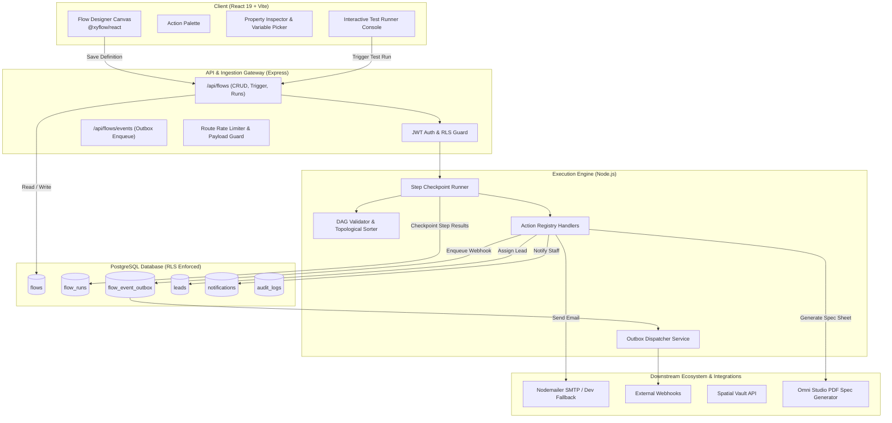

# I3DION Flow — Technical Architecture Specification v1.0
**Document Version:** 1.0 • **Author:** Antigravity (Platform Architect)

---

## 1. System Overview & Component Diagram



---

## 2. Execution Engine Lifecycle & State Machine

### 2.1 Run Lifecycle Transitions
```
                +-------------+
                |   PENDING   |
                +------+------+
                       |
                       v
                +-------------+
        +------>|   RUNNING   |<-------+
        |       +------+------+        |
        |              |               |
(Delay / Approval)     |       (Retry on failure)
        |              v               |
        |       +-------------+        |
        +-------| STEP RUNNER |--------+
                +------+------+
                       |
       +---------------+---------------+
       |               |               |
       v               v               v
+-------------+ +-------------+ +-------------+
|  SUCCEEDED  | |   FAILED    | |  TIMED_OUT  |
+-------------+ +-------------+ +-------------+
```

### 2.2 Step Checkpointing Contract
1. When execution begins, a new row is created in `flow_runs` with `status: 'running'`.
2. Before executing each step, the step state is marked `running`.
3. After the step finishes, its duration (ms), outputs, and status are committed to PostgreSQL inside the tenant's transaction.
4. If a worker process crashes, the run can be resumed from the last completed checkpoint without re-running prior non-idempotent side effects.
