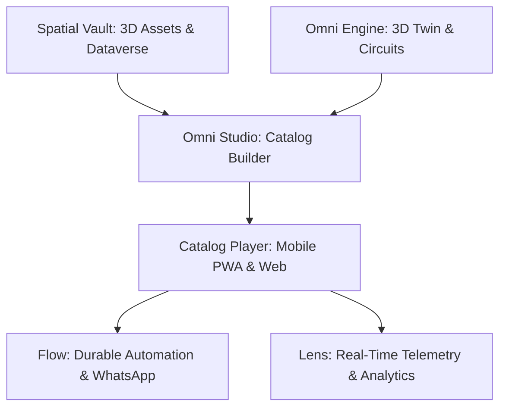

# Getting Started with I3DION Spatial

Welcome to **I3DION Spatial**, the comprehensive enterprise platform for 3D spatial product experiences, relational catalog data, and durable sales automation.

---

## 1. Quick Start Checklist

Follow these 5 steps to launch your first interactive spatial catalog:

1. **Set Up Your Organization**: Navigate to **Settings $\to$ Organization** to configure your company branding, logo, and team roles.
2. **Ingest 3D Models into Spatial Vault**: Upload your GLB, GLTF, or USDZ models into **Spatial Vault**. Assets are automatically deduplicated via SHA-256 and verified for web rendering.
3. **Design Your Catalog in Omni Studio**: Open **Omni Studio** to arrange multi-page responsive layouts using the Drag-and-Drop Canvas or the bidirectional YAML editor.
4. **Configure Interactive 3D Scenes & Circuits in Omni Engine**: Add hotspots, explode animations, material variants, and logic circuits to your 3D parts.
5. **Publish & Share**: Generate non-enumerable 108-bit QR codes or embed codes to distribute your catalog across mobile PWAs, trade shows, and dealer networks.

---

## 2. Platform Architecture Overview

- **Spatial Vault**: Enterprise SharePoint + Dataverse for 3D assets, custom relational schemas, and audit logs.
- **Omni Studio**: Visual canvas and declarative YAML engine for interactive, multi-screen sales catalogs.
- **Omni Engine**: 3D spatial scene composer with TransformControls, keyframe animations, and 70-chip circuit graphs.
- **Catalog Player**: Ultra-fast, offline-capable PWA with non-enumerable QR codes and AR QuickLook / WebXR.
- **Flow**: Durable, fault-tolerant background queue worker with step checkpoints, retry/DLQ, and WhatsApp business notifications.
- **Lens**: Live real-time spatial telemetry, 5-stage conversion funnels, 3D hotspot heatmaps, and Presenter Mode.
