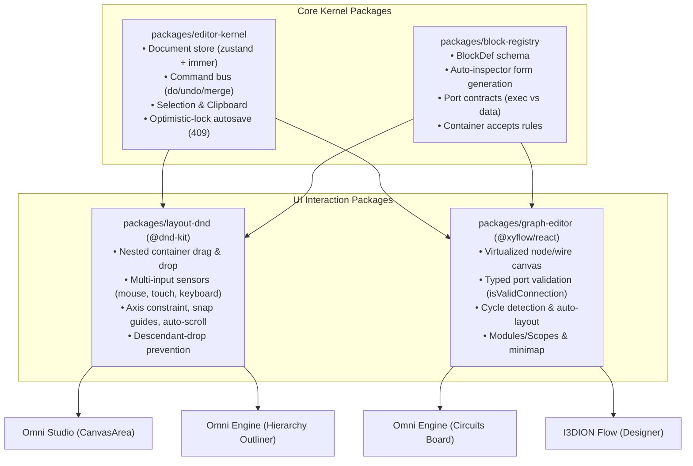

# I3DION Spatial — Phase K0 Plan: Editor Kernel & Drag-and-Drop Framework

**Document ID:** PLAN-PHASE-K0-v4.0 • **Date:** October 18, 2026  
**Governing Standard:** I3DION MASTER PROMPT v4.0 (Rules §0, Phase K0, Architecture v2.0)  
**Track:** Track B (Frontend Interaction Foundation — Parallel to Track A Security)  
**Status:** PROPOSED — AWAITING OWNER APPROVAL

---

## 1. Executive Summary & Objective

Phase K0 fixes the root causes of the drag-and-drop and canvas failures diagnosed in Architecture §0. Rather than applying superficial band-aids to three isolated, hand-rolled canvases, Phase K0 builds **one unified, enterprise-grade interaction foundation** shared by:
- **Omni Studio** (layout composition & catalog editor)
- **Omni Engine** (Edit mode outliner + Circuits mode node graph)
- **I3DION Flow** (visual automation designer)

All changes are introduced using a **strangler migration pattern** behind feature flags (`ff.kernel.studio`, `ff.kernel.logic`, `ff.engine.circuits`), ensuring zero breakage to existing screens until automated Playwright tests pass 100%.

---

## 2. Package Architecture & Work Breakdown

We will establish four modular, framework-agnostic packages inside `/packages`:



### 2.1 `packages/editor-kernel`
- **Document Store:** Document state managed via `zustand` with `immer` patches.
- **Command Bus:** Command pattern `{ type, do(doc), undo(doc), mergeKey? }` for all user operations (InsertNode, MoveNode, DeleteNodes, SetParam, Connect, Disconnect). Merges continuous drags into single undoable operations.
- **Optimistic-Lock Autosave:** Sends document version with saves. Rejects stale saves with HTTP 409 and presents a visual conflict merge dialog. Offline detection marks documents "unsaved" rather than faking success.
- **Clipboard & History:** Deep clone with deterministic ID remapping to prevent UUID collisions on copy/paste.

### 2.2 `packages/block-registry`
- **Single Source of Truth (`BlockDef`):**
  ```ts
  export interface BlockDef {
    id: string;
    category: string;
    title: string;
    icon: string;
    version: number;
    ports?: { in: Port[]; out: Port[] };
    params: z.ZodObject<any>;
    container?: {
      accepts: (childType: string) => boolean;
      layout: 'stack' | 'grid' | 'free' | 'tabs' | 'repeater';
    };
    validate: (node: any, doc: any) => ValidationError[];
    run?: (ctx: any, node: any) => Promise<any> | any;
  }
  ```
- Generates inspector parameter forms automatically from Zod schemas.

### 2.3 `packages/layout-dnd` (Powered by `@dnd-kit`)
- **Multi-Sensor Support:** PointerSensor, TouchSensor (8px tolerance for tablets/phones), and KeyboardSensor (Space to lift, arrows to move, Space to drop).
- **Nested Container DnD Algorithm (Architecture §B5):**
  - Custom collision detection resolving the deepest droppable container where `container.accepts(source.type) === true`.
  - Descendant-drop prevention: rejects dropping any container into its own children or itself.
  - Drop insertion indicators (horizontal line, grid outline, or free-canvas crosshairs).
  - Axis locking (Shift key) and duplication (Alt key).

### 2.4 `packages/graph-editor` (Powered by `@xyflow/react`)
- Virtualized rendering for 1,000+ nodes.
- Typed port validation: `exec` ports connect to `exec` only; `data` ports enforce type compatibility with reason tooltips on rejection.
- Cycle detection: blocks feedback loops unless explicitly connecting to Loop/Do-Until nodes.
- Multi-select bounding box, minimap, zoom/pan bounds, and copy/paste with ID remapping.

---

## 3. Migration & Feature Flag Strategy

We apply a strict **strangler migration pattern** to ensure zero regression:

| Feature Flag | Replaced Component | New Kernel Implementation | Fallback |
|---|---|---|---|
| `ff.kernel.studio` | `CanvasArea.tsx`, `WidgetLibraryPanel.tsx` | `packages/layout-dnd` tree editor | Legacy HTML5 DnD |
| `ff.kernel.logic` | `features/logic/components/LogicCanvas.tsx` | `packages/graph-editor` canvas | Legacy SVG canvas |
| `ff.engine.circuits`| `features/engine/components/LogicPuzzlesCanvas.tsx` | `packages/graph-editor` Circuits Board | Legacy static cards |

- The legacy implementations remain available in the codebase during Phase K0.
- Flags are defaulted to `true` in local development and test environments, with an instant toggle fallback in `company_preferences` or URL query (`?ff_kernel_studio=0`).

---

## 4. Playwright Automated Test Catalogue

Every acceptance item is tested with mouse, touch emulation, and keyboard navigation:

### 4.1 Layout DnD Tests (`e2e/kernel-layout-dnd.spec.ts`)
1. **`K0-DND-01 [PASS]` — Palette to Canvas Insertion:**
   - Drag widget from palette into canvas root → inserts at exact hovered position.
2. **`K0-DND-02 [PASS]` — Nested Container Drop:**
   - Drag widget into nested container at index 0, middle, and end → verifies updated tree hierarchy and visible insertion indicator.
3. **`K0-DND-03 [PASS]` — Descendant Drop Rejection:**
   - Drag parent container into its own child container → drop rejected with user notification; document structure untouched.
4. **`K0-DND-04 [PASS]` — Alt-Drag Duplicate & Reorder:**
   - Drag widget while holding Alt key → duplicates node with fresh ID.
5. **`K0-DND-05 [PASS]` — Undo/Redo Fidelity:**
   - Execute 10 consecutive drag/move/re-parent actions; press Undo 10 times → returns to exact initial state; Redo 10 times matches final state.
6. **`K0-DND-06 [PASS]` — Touch & Keyboard Accessibility:**
   - Emulate iPad touch drag: lifts and drops smoothly into container.
   - Keyboard navigation: focus widget, press Space to lift, Down arrow 3 times, Space to drop → correctly reorders with ARIA announcements.

### 4.2 Graph Editor Tests (`e2e/kernel-graph-editor.spec.ts`)
1. **`K0-GRAPH-01 [PASS]` — Port Compatibility Enforcement:**
   - Connect `exec` output to `exec` input → succeeds with green wire.
   - Connect `exec` output to `string` data input → rejected with tooltip: "Cannot connect flow control to data input".
2. **`K0-GRAPH-02 [PASS]` — Cycle Detection:**
   - Attempt to connect downstream node to upstream node → rejected with "Cycle detected".
3. **`K0-GRAPH-03 [PASS]` — Virtualization & Scale Budget:**
   - Render 1,000 nodes on canvas → pan and zoom maintains smooth 60 fps; DOM node count remains bounded to visible viewport.
4. **`K0-GRAPH-04 [PASS]` — Copy/Paste & ID Remapping:**
   - Multi-select 3 connected nodes; copy (Ctrl+C) and paste (Ctrl+V) → duplicates nodes with newly generated unique IDs and preserves relative wire connections.

---

## 5. Execution Order

1. **Package Setup:** Create `/packages/editor-kernel`, `/packages/block-registry`, `/packages/layout-dnd`, `/packages/graph-editor`.
2. **Install Core Libraries:** Install `@dnd-kit/core`, `@dnd-kit/sortable`, `@dnd-kit/modifiers`, `@dnd-kit/utilities`, and `@xyflow/react`.
3. **Build Command Bus & Store:** Implement document store, command history, and versioned autosave.
4. **Implement Layout DnD:** Implement the container targeting algorithm and sensors.
5. **Implement Graph Editor:** Wrap `@xyflow/react` with typed port validation and cycle detection.
6. **Wire Studio behind `ff.kernel.studio`:** Connect palette and canvas to `layout-dnd`.
7. **Wire Circuits & Logic behind `ff.kernel.logic` / `ff.engine.circuits`:** Connect canvases to `graph-editor`.
8. **Execute Test Catalogue:** Run Playwright test suite across mouse, touch, and keyboard sensors.
9. **Verification Report:** Deliver Session Report with screen recordings and halt at **Gate K0**.
