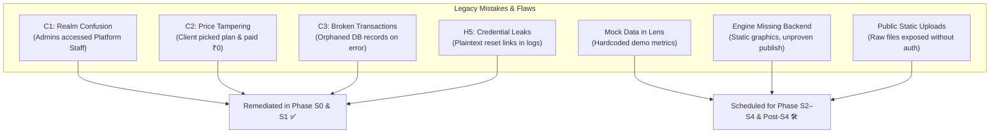
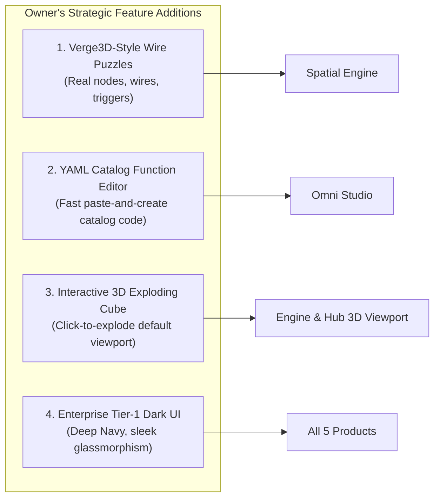
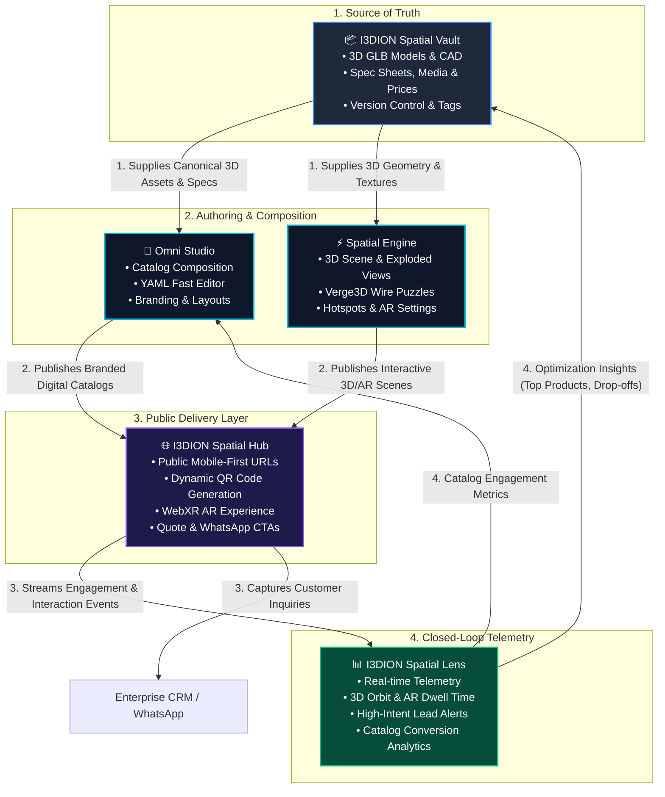
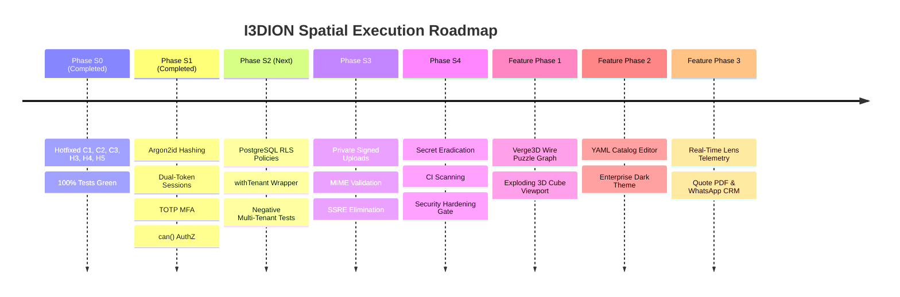

# I3DION Spatial — Unified Ecosystem Review, Mistakes, Improvements & Connectivity Roadmap

**Document Version:** v2.1 • **Date:** October 18, 2026  
**Target Architecture:** I3DION Spatial Ecosystem (`sabarivasan77/I3DION_Spatial`)  
**Scope:** Complete Product Suite (Vault, Studio, Engine, Hub, Lens, Platform Core, Connectors)

---

## 1. Executive Summary & Purpose

This document provides a single, unified, plain-English reference answering the four core questions for the I3DION Spatial ecosystem:
1. **What are the mistakes in the system currently?** (Factual audit of vulnerabilities, architectural flaws, and false assumptions).
2. **What are the improvements needed?** (Systemic upgrades in security, data integrity, testing, and UI/UX).
3. **What features will be added?** (Security roadmap S2–S4 + Owner's 4 strategic features + commercial tools).
4. **How do all products connect together into one seamless workflow?** (The closed-loop data pipeline from Vault → Studio/Engine → Hub → Lens).

---

## 2. What Were the Mistakes? (Current Flaws & Audit Realities)

Our deep code audit of the ~77,000 LOC codebase revealed that while I3DION Spatial possessed impressive breadth, it suffered from **low operational readiness (35.5/100 score)** due to critical security defects, disconnected silos, and placeholder code.

### Detailed Breakdown of Mistakes:
1. **Security & Authorization Vulnerabilities:**
   - **C1 (Platform Admin Confusion):** Any tenant user with role `"Admin"` could access platform staff management endpoints (`/api/platform-admin`). *(Fixed in S0 commit `59df344`)*.
   - **C2 (Payment Tampering):** The client could alter `planId` during payment verification to obtain a ₹149,990 UNLIMITED plan for ₹1,499. *(Fixed in S0 commit `192340d`)*.
   - **C3 (Non-atomic Signups):** `pool.query('BEGIN')` on connection pools failed to bind transactions, leaving orphaned records if token signing failed. *(Fixed in S0 commit `7fb2d7f`)*.
   - **H5 (Credential Exposure):** Password reset tokens were reusable and logged in plaintext to `console.log`. *(Fixed in S0 commit `83ceaa4`)*.
   - **Missing Database Row-Level Security (RLS):** Database queries relied solely on manual `WHERE organization_id = $1` filters in Node.js without PostgreSQL RLS defense-in-depth.
2. **Data Integrity & Mock Gaps:**
   - **Spatial Lens Run on Mock Data:** The analytics dashboards in Lens did not query live telemetry; they pulled static numbers from `defaultLensData.ts`.
   - **Spatial Engine Lacked Dedicated Backend:** Engine had ~2,500 lines of frontend editor UI, but no dedicated persistence route, relying on client-side state.
   - **Placeholder Static Assets:** The Engine interface defaulted to static 2D placeholder images (e.g. worker photos) rather than an interactive, live 3D viewport.
3. **Product Disconnection (Silos):**
   - Products acted as independent islands rather than referencing canonical records in Vault. Changes made to assets in Vault did not propagate cleanly or reliably into Studio or Engine.
4. **File Storage & Upload Risks:**
   - Files uploaded to `/uploads` were served via unauthenticated static file middleware (`express.static`), allowing anyone with the URL to view proprietary 3D CAD/GLB models.

---

## 3. What Improvements Are Needed?

To evolve from a Prototype (35.5/100) to an Enterprise-Ready, Market-Competitive Platform (72+/100), the following improvements are required across four pillars:

| Pillar | Current State | Required Improvement | Target Impact |
|---|---|---|---|
| **1. Tenant Isolation & Data Layer** | App-level `WHERE` filters; no DB policies | PostgreSQL Row-Level Security (RLS) on all tenant tables + `withTenant(orgId, fn)` wrapper | Eliminates any chance of cross-tenant data leaks |
| **2. Storage & Asset Security** | Static `/uploads/` folder with public URLs | Private object storage with pre-signed, time-limited, tenant-validated URLs | Protects proprietary 3D CAD assets and customer files |
| **3. UI/UX & Visual Design** | Standard gray/white cards; static placeholder images | Tier-1 Enterprise Dark Theme (`#0B0F19`, slate cards, cyan/blue accents) + real 3D default viewports | WOW factor, high perceived value for enterprise buyers |
| **4. Testing & Code Quality** | Manual testing; Playwright tests with mock bypass | 100% automated regression suites (`npm test` 10/10 green) + CI/CD automated pipeline | Zero breaking changes, high software stability |

---

## 4. What Features Will Be Added?

### 4.1 Owner's 4 Strategic High-Priority Features (Roadmap Priority)

Following explicit owner direction, four transformative capabilities will be introduced into the product suite:

1. **Verge3D-Style Logic Wire Puzzles (Spatial Engine):**
   - **What it is:** A visual logic node graph inspired by Verge3D and Unreal Blueprints.
   - **How it works:** Replaces rigid UI containers with interactive logic nodes connected by dynamic spline wires. Nodes handle 3D events (e.g. *On Click*, *On Proximity*, *On Animation Finish*), logic gates (*Branch*, *Delay*, *Loop*), and spatial actions (*Play Animation*, *Show Hotspot*, *Explode Model*, *Change Material*, *Open Quote Modal*).
   - **Value:** Creators can build rich interactive product digital twins without writing raw JavaScript.
2. **YAML Catalog Function & Layout Editor (Omni Studio):**
   - **What it is:** A bi-directional visual + code editor for product catalogs.
   - **How it works:** Users can either drag-and-drop catalog cards or paste a concise YAML snippet defining sections, products, layout grids, action buttons, and price rules. The editor parses the YAML instantly and renders the catalog preview in real time.
   - **Value:** Enterprise teams can rapidly duplicate, version, or bulk-generate complex catalogs in seconds.
3. **Interactive 3D Exploded-Cube Default Viewport (Spatial Engine):**
   - **What it is:** A native 3D default scene replacing static 2D placeholder images.
   - **How it works:** When a creator opens Spatial Engine without a selected model, an elegant, bevelled 3D industrial cube appears on an infinite grid. Clicking or tapping the cube triggers a smooth, physics-inspired explosion animation revealing the internal core, sub-assemblies, and interactive hotspots.
   - **Value:** Provides an instant, captivating 3D demonstration that demonstrates the power of the engine on first load.
4. **Enterprise Tier-1 Dark Theme & Design Tokens (Ecosystem-Wide):**
   - **Palette:** Deep Obsidian Base (`#0B0F19`), Slate Panel Surfaces (`#1E293B`), Electric Spatial Blue (`#3B82F6`), Neon Cyan Accents (`#06B6D4`), and Subtle Glow Borders (`rgba(59, 130, 246, 0.2)`).
   - **Typography & Motion:** Inter / Outfit typography, smooth CSS transitions, glowing connection lines, and responsive layouts.

### 4.2 Security & Platform Foundation (Phases S2–S4)
- **Phase S2:** Row-Level Security (RLS) across all PostgreSQL tables, dedicated unprivileged `i3dion_app` DB role, sequential migration files.
- **Phase S3:** Secure private upload pipeline, pre-signed S3/R2 URLs, magic-number MIME type validation, and server-side model validation.
- **Phase S4:** Git history rewrite (expunging historical credentials), automated CI secret scanning, rate limiting on all public endpoints.

### 4.3 Commercial & Workflow Features
- **Live Spatial Lens Event Pipeline:** Real-time WebSocket/REST event ingestion capturing 3D interaction time, AR launches, and QR scan attribution.
- **Quote PDF Generation:** Server-side PDF generation for quotes and catalog summaries.
- **WhatsApp Direct Inquiries:** Direct "Chat on WhatsApp" button on public Hub pages linking prospective buyers to dealers with pre-populated product specs.

---

## 5. How All Products Connect Together (Unified Closed-Loop Ecosystem)

The strength of I3DION Spatial lies in treating the 5 primary products as **interconnected stages of a single product journey** rather than isolated tools.

### The 4-Stage Lifecycle Explained:

1. **Stage 1 — Canonical Source of Truth (Spatial Vault):**
   - The company's engineering or marketing team uploads CAD models, GLB files, technical data sheets, and price rules once into **Vault**.
   - Vault tags, versions, and secures the assets. Vault is the **single master record**; no other product copies or stores duplicate files.
2. **Stage 2 — Product Composition & Experience Authoring:**
   - **Omni Studio** pulls product records from Vault. Marketers arrange products into interactive digital catalogs using visual cards or the **YAML Catalog Editor**.
   - **Spatial Engine** pulls 3D geometry from Vault. Technical designers configure camera angles, hotspots, exploded views (such as the default exploding cube), and interactive behavior using **Verge3D-style Wire Puzzles**.
3. **Stage 3 — Omnichannel Public Delivery (Spatial Hub):**
   - Studio and Engine publish frozen, immutable versions to **Spatial Hub**.
   - Hub generates unique short URLs and dynamic QR codes for each product or catalog.
   - When an end-user or industrial buyer scans the QR code at a trade show or machinery dealer, Hub loads the interactive 3D model in mobile WebXR/AR with zero software installation.
   - Buyers can view hotspots, explode parts, click "Request Quote", or click "Chat on WhatsApp".
4. **Stage 4 — Intelligence & Feedback Loop (Spatial Lens):**
   - Every visitor interaction on Hub (e.g. seconds spent inspecting a specific machine part, AR placement success, hotspot click, PDF download) streams to **Spatial Lens**.
   - Lens aggregates these events into live conversion funnels, notifying the sales team of high-intent leads and showing product managers which features attract the most customer attention.

---

## 6. Implementation Strategy & Next Steps

To execute this roadmap efficiently without breaking security or stability, we follow the established **Security-First Phased Execution Model**:

1. **Current Milestone (Gate S1):** Successfully completed! All 10 backend test suites (`npm test`) pass with 0 errors.
2. **Immediate Step (Phase S2):** Implement database-level Row-Level Security (RLS) to guarantee multi-tenant boundary protection.
3. **Subsequent Step (Phases S3 & S4):** Finalize secure asset storage and clean secret history.
4. **Feature Execution (Post-Gate-S4):** Build the 4 owner-requested UI/UX features (Verge3D Wire Puzzles, YAML Catalog Editor, 3D Exploding Cube, and Enterprise Dark Theme) on top of an unbreakable, certified security foundation.
